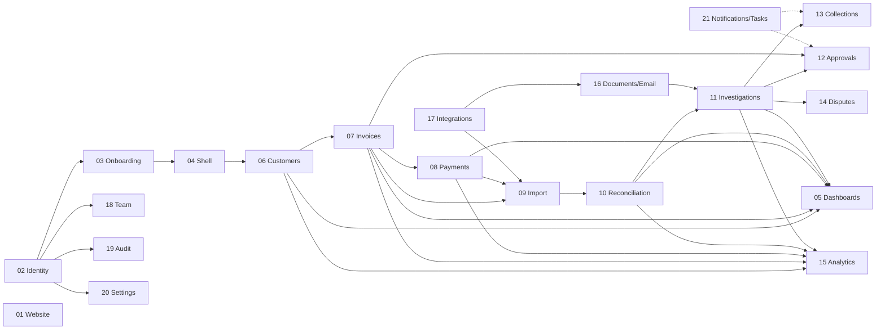

# venn: frontend modules

Status: Phase 3 · Last updated 2026-11-15

This folder divides the approved frontend (`apps/web`, visual reference `design-v2`) into 21 modules. Each module file holds its scope, use cases, functional requirements (FRs), non-functional requirements (NFRs), test cases and the backend contract it needs. The delivery plan that builds them end to end is [../planning/MODULE_DELIVERY_PLAN.md](../planning/MODULE_DELIVERY_PLAN.md).

These files refine, and do not replace, [FEATURE_SPECIFICATION.md](../planning/FEATURE_SPECIFICATION.md) (business rules), [ROLE_PERMISSION_MATRIX.md](../planning/ROLE_PERMISSION_MATRIX.md), [API_SPECIFICATION.md](../planning/API_SPECIFICATION.md) and [DATABASE_DESIGN.md](../planning/DATABASE_DESIGN.md). Where a module file and the feature specification disagree, the difference is listed in that module's "Gaps" section and needs a decision.

Totals across the 21 modules: **147 use cases, 202 functional requirements, 181 test cases**, plus 14 global NFRs and module NFRs.

## Module map

| ID | Module | Routes | Feature spec | Roadmap |
|---|---|---|---|---|
| [MOD-01](MOD-01-public-website.md) | Public website | `/`, `/pricing`, `/p/:slug`, `/about`, `/contact`, `/privacy`, `/terms` | §B.19 | M16 |
| [MOD-02](MOD-02-identity-and-access.md) | Identity and access | `/login`, `/signup`, `/verify-email`, `/forgot-password`, `/reset-password`, `/invite/:token`, `/session-expired`, `/403` | §B.1 | M5 |
| [MOD-03](MOD-03-onboarding.md) | Onboarding and first run | `/onboarding/:step`, first-run dashboard | §B.1 | M5–M6 |
| [MOD-04](MOD-04-app-shell.md) | App shell and navigation | `/app/*` layout, `/500`, `/maintenance`, 404 | — | M6 |
| [MOD-05](MOD-05-dashboards.md) | Dashboards | `/app` | §B.2, §B.3 | M6 skeleton, M14 data |
| [MOD-06](MOD-06-customers.md) | Customers | `/app/customers`, `/app/customers/:id` | §B.4 | M7 |
| [MOD-07](MOD-07-invoices.md) | Invoices | `/app/invoices`, `/app/invoices/:id` | §B.5 | M7 |
| [MOD-08](MOD-08-payments-and-allocations.md) | Payments and allocations | `/app/payments`, `/app/payments/:id` | §B.6, §A.4 | M8 |
| [MOD-09](MOD-09-data-import.md) | Data import | `/app/invoices/import`, `/app/payments/import`, `/app/invoices/pdf-review` | §B.5, §B.6 | M7–M8, M11 (PDF) |
| [MOD-10](MOD-10-reconciliation.md) | Reconciliation | `/app/reconciliation`, `/app/reconciliation/runs/:id` | §B.7 | M9 |
| [MOD-11](MOD-11-investigations.md) | Investigations | `/app/investigations`, `/app/investigations/:id` | §B.8 | M11 |
| [MOD-12](MOD-12-approvals-and-adjustments.md) | Approvals and adjustments | `/app/approvals`, `/app/approvals/:id` | §B.11 | M10 |
| [MOD-13](MOD-13-collections.md) | Collections | `/app/collections`, `/app/collections/:id` | §B.9 | M12 |
| [MOD-14](MOD-14-disputes.md) | Disputes | `/app/disputes`, `/app/disputes/:id` | §B.10 | M12 |
| [MOD-15](MOD-15-analytics-and-reports.md) | Analytics and reports | `/app/reports`, `/app/reports/:slug` | §B.12 | M14 |
| [MOD-16](MOD-16-documents-and-email.md) | Documents and email intelligence | `/app/documents` | §B.18 | M11, M13 |
| [MOD-17](MOD-17-integrations.md) | Integrations | `/app/integrations`, `/app/integrations/:id` | §B.13 | M13, M15 |
| [MOD-18](MOD-18-team-and-permissions.md) | Team and permissions | `/app/team`, `/app/team/:id` | §B.14 | M5 |
| [MOD-19](MOD-19-audit-log.md) | Audit log | `/app/audit-log` | §B.15 | M5 |
| [MOD-20](MOD-20-settings-and-profile.md) | Settings and profile | `/app/settings/:tab`, `/app/profile` | §B.16 | M5, M10 |
| [MOD-21](MOD-21-notifications-and-tasks.md) | Notifications and tasks | `/app/notifications`, `/app/tasks`, bell | §B.17 | M6, M12 |

## Conventions

| Item | Format | Example |
|---|---|---|
| Use case | `UC-<module>-<n>` | UC-07-03 |
| Functional requirement | `FR-<module>-<n>` | FR-07-12 |
| Module NFR | `NFR-<module>-<n>` | NFR-10-02 |
| Global NFR | `NFR-G-<n>` (below) | NFR-G-04 |
| Test case | `TC-<module>-<n>` | TC-08-05 |

**Priority:** Must (MVP blocker) · Should (MVP-Complete) · Could (post-MVP).

**Prototype status** (per FR), so the delivery plan knows what is left:
- **UI** – screen and interaction exist in `apps/web`, data is local (browser storage). Needs the API.
- **Partial** – the screen exists but some behaviour from the requirement is missing.
- **None** – not in the frontend yet.

**Test levels:** `U` unit (Vitest or Pytest) · `C` component (Vitest + Testing Library + MSW) · `A` API integration (Pytest + real Postgres) · `E` end to end (Playwright) · `M` manual/visual.

Roles: **Owner** and **AR** (AR specialist). The permission keys used in the files are those in ROLE_PERMISSION_MATRIX.

## Global non-functional requirements

Every module inherits these. A module file only lists NFRs that add to them.

| ID | Requirement | Measure | Verified by |
|---|---|---|---|
| NFR-G-01 | **Money is exact.** Amounts are decimal strings over the API, `NUMERIC(19,4)` in the database, never floats. The UI formats, it does not calculate totals the server owns. | No `parseFloat`/`Number()` on money in reviewed diffs; property tests on balance math | U, review |
| NFR-G-02 | **Tenant isolation.** No request can read or change another organization's data. | Cross-tenant test suite covers every endpoint; RLS forced on every tenant table | A |
| NFR-G-03 | **Authorization on the server.** UI hiding is cosmetic; every endpoint checks a permission. | RBAC matrix test: each endpoint × role | A |
| NFR-G-04 | **Audit.** Every mutation writes an append-only audit row in the same transaction. | Test per mutation asserts the audit row | A |
| NFR-G-05 | **Accessibility.** WCAG 2.2 AA: keyboard-only use, visible focus, labelled controls, landmarks, one `h1`, contrast ≥ 4.5:1 for text. | axe in Playwright on every route = 0 serious/critical; manual keyboard pass per module | E, M |
| NFR-G-06 | **Responsive.** Works at 390, 768, 1280 and 1440 px with no horizontal page scroll. | Playwright viewport sweep | E |
| NFR-G-07 | **States.** Every data view has loading, empty, error and permission-denied states. | Component tests with MSW for each state | C |
| NFR-G-08 | **Performance.** Initial JS ≤ 300 kB gzip for the entry; route chunks lazy-loaded. List API p95 ≤ 300 ms and aggregates p95 ≤ 800 ms on a 100k-invoice organization. LCP ≤ 2.5 s on the marketing home (4G profile). | Build size report; k6; Lighthouse CI | perf |
| NFR-G-09 | **Reliability.** Mutations are idempotent (`Idempotency-Key`); edits use optimistic concurrency (`If-Match`). A failed request never leaves the UI claiming success. | API tests for replay and `409 version_conflict`; component tests for error toasts | A, C |
| NFR-G-10 | **Security.** No secrets in the client; HTTP-only session cookies; CSP; inputs validated at the API with Pydantic and in forms with Zod; uploads type-sniffed and size-limited. | gitleaks, ZAP baseline, `npm audit`, `pip-audit` in CI | CI |
| NFR-G-11 | **Observability.** Every request has a request ID shown in error details; structured logs; frontend errors reported to the error tracker with the route and request ID, never with financial data. | Log/trace inspection in staging | M |
| NFR-G-12 | **Honesty of data.** No invented numbers. Every figure on screen traces to stored records; AI text cites evidence IDs. Claims from emails never count as payments. | Review + AI evaluation suites | U, review |
| NFR-G-13 | **Consistency.** Lowercase "venn"; shadcn/ui primitives and the design tokens in `index.css`; the visual result matches `design-v2` at 1440 and 390. | Visual comparison at each checkpoint | M |
| NFR-G-14 | **Browser support.** Last two versions of Chrome, Edge, Firefox, Safari; iOS Safari 17+. | Playwright projects for Chromium, Firefox, WebKit | E |
