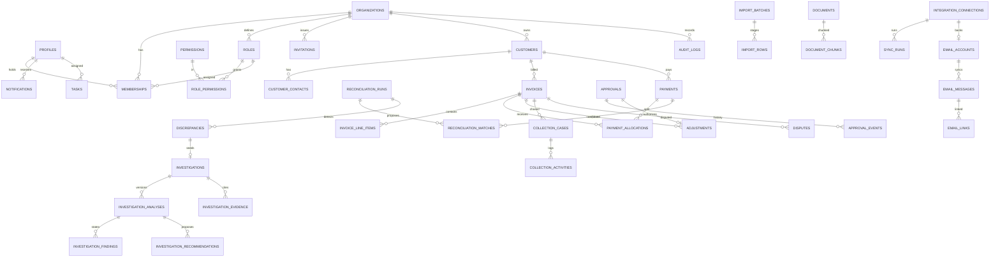

# Venn — Database Design

Status: Phase 1 draft · Last updated 2026-11-13

PostgreSQL with `pgvector`, `pg_trgm`, `citext`. SQLAlchemy 2.x models, Alembic migrations. Column lists below are the design contract; exact DDL is produced at each milestone and reviewed against this document.

## 1. Conventions

| Topic | Rule |
|---|---|
| Primary keys | `id uuid` (UUIDv7, generated in the application) |
| Tenant ownership | Every tenant table has `organization_id uuid not null references organizations(id)`; composite indexes lead with it |
| Tenant-safe foreign keys | Child rows reference parents with composite FKs `(organization_id, parent_id)` against a unique `(organization_id, id)` on the parent, so a row can never point at another tenant's record |
| Money | `numeric(19,4)`, with `currency char(3)` beside every amount set; CHECKs for non-negativity |
| Time | `timestamptz` in UTC for events; `date` for business dates |
| Standard columns | `created_at`, `updated_at`, `created_by`, `version int not null default 1` (optimistic locking) on mutable business tables |
| Enums | `text` + CHECK constraint (easier to migrate than native enums) |
| Deletion | No hard delete of financial rows. `voided_at` / `cancelled_at` / `archived_at` instead |
| Source tracking | Imported/synced rows carry `source`, `external_id`, `import_batch_id`, `raw jsonb` |
| Human numbers | `number text` unique per organization, from `org_sequences` |
| JSONB | Only for genuinely variable data: raw payloads, settings, audit before/after, AI structured output snapshots |
| RLS | Enabled and **forced** on every tenant table (§6) |

Abbreviations in tables: PK, FK, UQ (unique), IX (index), NN (not null). `org` = `organization_id`.

## 2. Entity-relationship diagram



## 3. Tables

### 3.1 Identity and access

**profiles** — application profile for a Supabase auth user. *Not tenant-scoped.*
| Column | Type | Notes |
|---|---|---|
| id | uuid PK | = `auth.users.id` (FK, on delete restrict) |
| email | citext NN UQ | mirrored from auth for display/search |
| full_name | text NN | |
| last_active_org_id | uuid FK organizations null | |
| created_at, updated_at | timestamptz | |

**organizations**
| Column | Type | Notes |
|---|---|---|
| id | uuid PK | |
| name | text NN | |
| legal_name, website | text null | |
| industry, company_size | text NN | CHECK lists |
| country | char(2) NN | |
| default_currency | char(3) NN | |
| timezone | text NN | IANA name |
| settings | jsonb NN | financial prefs: `auto_apply_exact`, grace days, default terms |
| onboarding_state | jsonb NN | step progress |
| remittance_details | bytea null | encrypted; changes logged in `remittance_changes` |
| status | text NN | `active`, `suspended`, `deletion_requested` |
| created_by | uuid FK profiles | |
RLS: member of the organization.

**roles** — `id`, `org` (NN), `key` (`owner`, `ar_specialist`, later custom), `name`, `is_system bool`, `is_locked bool` (owner). UQ `(org, key)`.

**permissions** — global catalog. `key text PK`, `description`, `group`, `grantable_to_non_owner bool`. Seeded by migration.

**role_permissions** — `role_id FK`, `permission_key FK`, `org`. PK `(role_id, permission_key)`.

**memberships**
| Column | Type | Notes |
|---|---|---|
| id | uuid PK | |
| org | uuid NN | |
| user_id | uuid FK profiles NN | |
| role_id | uuid FK roles NN | composite FK with org |
| status | text NN | `active`, `suspended`, `removed` |
| invited_by | uuid null | |
| joined_at, suspended_at | timestamptz | |
UQ `(org, user_id)`. IX `(user_id, status)`. Trigger: reject a change that leaves the organization with zero active owners (deferred constraint trigger, also checked in the service).

**invitations** — `id`, `org`, `email citext NN`, `role_id`, `token_hash bytea NN UQ` (SHA-256 of a 32-byte random token; raw token only in the email), `status` (`pending`, `accepted`, `revoked`, `expired`), `expires_at`, `invited_by`, `accepted_by`, `accepted_at`, `last_sent_at`, `send_count`. Partial UQ `(org, email) where status = 'pending'`.

**approval_policies** — `id`, `org`, `action_type`, `mode` (`always`, `above_threshold`, `never`), `threshold_amount numeric(19,4)`, `currency`, `is_locked`. UQ `(org, action_type, currency)`.

**org_sequences** — `org`, `kind`, `next_value bigint`. PK `(org, kind)`; incremented with `UPDATE … RETURNING` inside the creating transaction.

### 3.2 Customers

**customers**
| Column | Type | Notes |
|---|---|---|
| id, org | | |
| name | text NN | IX trigram |
| legal_name, tax_id | text null | |
| external_id, source | text null | UQ `(org, source, external_id)` where not null |
| default_currency | char(3) null | |
| payment_terms_days | int null | CHECK ≥ 0 |
| billing_address | jsonb null | |
| payer_aliases | text[] NN default '{}' | names seen on bank lines; GIN index |
| email_domains | text[] NN default '{}' | for email linking |
| status | text NN | `active`, `archived` |
| notes | text null | |

**customer_contacts** — `id`, `org`, `customer_id`, `name`, `email citext`, `phone`, `role`, `is_billing_contact bool`. IX `(org, email)`.

### 3.3 Invoices

**invoices**
| Column | Type | Notes |
|---|---|---|
| id, org | | |
| customer_id | uuid NN | composite FK |
| invoice_number | text NN | |
| po_number | text null | |
| issue_date, due_date | date NN | CHECK `due_date ≥ issue_date` |
| currency | char(3) NN | |
| subtotal_amount, tax_amount | numeric(19,4) null | |
| total_amount | numeric(19,4) NN | CHECK > 0 |
| amount_paid | numeric(19,4) NN default 0 | maintained; CHECK ≥ 0 |
| amount_adjusted | numeric(19,4) NN default 0 | maintained; CHECK ≥ 0 |
| balance_due | numeric(19,4) NN | CHECK `= total_amount − amount_paid − amount_adjusted` and ≥ 0 |
| lifecycle_status | text NN | `draft`, `issued`, `cancelled` |
| cancelled_at, cancel_reason | | |
| description | text null | |
| source, external_id, import_batch_id, raw | | |
| version | int | |
UQ `(org, customer_id, invoice_number) where lifecycle_status <> 'cancelled'`. IX `(org, due_date) where balance_due > 0 and lifecycle_status = 'issued'` (overdue queries); IX `(org, customer_id)`; IX `(org, invoice_number)`; trigram IX on `invoice_number`.

**invoice_line_items** — `id`, `org`, `invoice_id`, `position int`, `description`, `quantity numeric(19,4)`, `unit_price numeric(19,4)`, `amount numeric(19,4) NN`, `tax_amount`. No constraint forcing lines to sum to the total (imports often lack lines); a mismatch is a warning surfaced in the UI.

**adjustments** — approved non-cash changes and refund records.
| Column | Type | Notes |
|---|---|---|
| id, org, number | | `ADJ-0001` |
| invoice_id | uuid NN | |
| type | text NN | `credit`, `discount`, `write_off`, `refund_record` |
| amount | numeric(19,4) NN | CHECK > 0 |
| currency | char(3) NN | must equal invoice currency (trigger) |
| reason | text NN | |
| status | text NN | `pending_approval`, `applied`, `rejected`, `voided` |
| approval_id | uuid null | NN when status = `applied` unless `owner_direct` |
| owner_direct | bool NN default false | single-owner exception |
| applied_at, voided_at | timestamptz | |
| linked_payment_id | uuid null | for `refund_record`: the outgoing transaction once imported |
`credit`, `discount`, `write_off` reduce `balance_due` when applied. `refund_record` does not change the invoice balance; it records an amount owed back to the customer.

### 3.4 Payments

**payments**
| Column | Type | Notes |
|---|---|---|
| id, org, number | | `PAY-0001` |
| customer_id | uuid null | unknown payer allowed |
| direction | text NN | `in`, `out` |
| payment_date | date NN | |
| amount | numeric(19,4) NN | CHECK > 0 |
| currency | char(3) NN | |
| allocated_amount | numeric(19,4) NN default 0 | CHECK `0 ≤ allocated_amount ≤ amount` |
| method | text null | |
| reference, memo | text null | trigram IX on reference |
| payer_name_raw | text null | |
| verification_level | text NN | `source_verified`, `manual` |
| under_review | bool NN default false | |
| reversed_at, reversal_reason | | |
| source, external_id, import_batch_id, raw, fingerprint | | |
UQ `(org, source, external_id)` where not null; UQ `(org, fingerprint)` for CSV rows (fingerprint = hash of date, amount, currency, reference, payer; a genuine identical second row is surfaced as a duplicate for the user to accept explicitly). IX `(org, payment_date)`; IX `(org) where allocated_amount < amount and reversed_at is null`.

**payment_allocations**
| Column | Type | Notes |
|---|---|---|
| id, org | | |
| payment_id, invoice_id | uuid NN | composite FKs |
| amount | numeric(19,4) NN | CHECK > 0 |
| currency | char(3) NN | |
| method | text NN | `auto_rule`, `suggestion_confirmed`, `manual` |
| reconciliation_match_id | uuid null | |
| created_by | uuid null | null = system |
| voided_at, voided_by, void_reason | | |
Partial UQ `(payment_id, invoice_id) where voided_at is null`. Constraint trigger (deferred, runs at commit) verifies for the touched payment and invoice: Σ active allocations = `payments.allocated_amount` ≤ `amount`; `invoices.amount_paid` = Σ active allocations; currencies equal; invoice not cancelled. The service layer performs the same checks under row locks; the trigger is the backstop.

**bank_transactions** — *evaluated, deferred to the bank-feed milestone (post-MVP).* It will hold raw statement lines that link to `payments`. See challenge C-7.

### 3.5 Imports

**import_batches** — `id`, `org`, `kind` (`invoices`, `payments`, `customers`), `file_name`, `file_sha256`, `storage_key`, `column_mapping jsonb`, `status` (`uploaded`, `validated`, `importing`, `completed`, `failed`, `cancelled`), row counters (`total`, `valid`, `warning`, `error`, `duplicate`, `created`), `created_by`, timestamps. IX `(org, file_sha256)`.

**import_rows** — `id`, `org`, `batch_id`, `row_number`, `raw jsonb`, `parsed jsonb`, `status` (`valid`, `warning`, `error`, `duplicate`, `conflict`, `imported`, `skipped`), `messages jsonb`, `created_record_id`. Purged 90 days after completion.

**column_mappings** — `org`, `kind`, `header_signature`, `mapping jsonb`: remembered mapping per file layout.

### 3.6 Reconciliation

**reconciliation_runs** — `id`, `org`, `trigger` (`import`, `manual`, `scheduled`, `sync`), `status`, `started_at`, `finished_at`, counters (`payments_examined`, `auto_applied`, `suggested`, `unmatched`, `discrepancies`), `rules_version`, `started_by`.

**reconciliation_matches** — a proposed (or applied) match.
| Column | Notes |
|---|---|
| id, org, run_id, payment_id | |
| rule | `R1`…`R6` |
| confidence | `exact`, `high`, `medium`, `low` |
| proposed_allocations jsonb | `[{invoice_id, amount}]` snapshot |
| explanation | text, generated by rule code |
| ai_rank, ai_rationale | null unless AI assist ran |
| status | `suggested`, `auto_applied`, `confirmed`, `rejected`, `superseded`, `undone` |
| decided_by, decided_at | |
IX `(org, status)`, `(org, payment_id)`.

**discrepancies**
| Column | Notes |
|---|---|
| id, org, number | `DSC-0001` |
| type | `short_payment`, `overpayment`, `duplicate_payment`, `unmatched_payment`, `missing_payment_claimed`, `misallocation`, `currency_mismatch`, `duplicate_invoice`, `other` |
| customer_id, invoice_id, payment_id | nullable, per type |
| expected_amount, actual_amount, exposure_amount, currency | computed by rule code |
| detected_by | `rule`, `user` |
| run_id | null for user-created |
| status | `open`, `investigating`, `resolved`, `dismissed` |
| dedupe_key | UQ `(org, dedupe_key) where status in ('open','investigating')` so re-runs do not duplicate |

### 3.7 Investigations

**investigations** — `id`, `org`, `number` (`INVG-0001`), `discrepancy_id` (nullable, UQ), `title`, `customer_id`, `primary_invoice_id`, `exposure_amount`, `currency`, `priority`, `status` (`new`, `investigating`, `ready_for_review`, `awaiting_approval`, `action_taken`, `monitoring`, `resolved`, `dismissed`), `assignee_id`, `current_analysis_id`, `chosen_action`, `follow_up_date`, `outcome`, `verified_recovered_amount numeric(19,4) default 0`, `resolved_at`, `resolution_note`, `version`. IX `(org, status)`, `(org, assignee_id, status)`.

**investigation_evidence** — one row per citable item.
| Column | Notes |
|---|---|
| id, org, investigation_id | |
| kind | `invoice`, `payment`, `allocation`, `document`, `document_chunk`, `email`, `customer`, `adjustment`, `note` |
| ref_id | id of the referenced record |
| locator jsonb | page number / chunk id / email part |
| excerpt | text, the quoted snippet (≤ 1,000 chars) |
| tier | 1–4 (evidence hierarchy) |
| added_by | `system` or user id |
| snapshot jsonb | key facts at time of capture, so later edits do not rewrite history |
UQ `(investigation_id, kind, ref_id, locator)`.

**investigation_analyses** — versioned engine output. `id`, `org`, `investigation_id`, `version_no`, `status` (`running`, `completed`, `failed`), `narrative text`, `narrative_citations jsonb`, `calculations jsonb` (deterministic), `ai_run_id`, `records_fingerprint` (hash of input record versions, to detect staleness), `created_at`.

**investigation_findings** — `id`, `org`, `analysis_id`, `category` (`confirmed_fact`, `possible_explanation`, `unverified_claim`, `missing_evidence`, `calculation`), `statement`, `evidence_ids uuid[]`, `origin` (`deterministic`, `ai`, `user`), `position`. CHECK: `confirmed_fact` and `unverified_claim` require at least one evidence id.

**investigation_recommendations** — `id`, `org`, `analysis_id`, `action_key` (from the catalog), `rationale`, `evidence_ids`, `is_primary`, `requires_approval bool` (set by policy code, not AI), `draft_payload jsonb`.

**record_notes** — shared internal notes: `id`, `org`, `record_type`, `record_id`, `body`, `author_id`, `created_at`, `edited_at`.

**record_events** — shared timeline for investigations, disputes, collection cases: `id`, `org`, `record_type`, `record_id`, `event_type`, `payload jsonb`, `actor_id`, `created_at`. (Operational history shown in the UI; the security record is `audit_logs`.)

### 3.8 Collections and disputes

**collection_cases** — `id`, `org`, `number`, `customer_id`, `invoice_id` (UQ where open), `stage`, `status` (`open`, `paused`, `closed`), `priority_score numeric`, `priority_reasons jsonb`, `owner_id`, `next_action_date`, `promise_date`, `promise_amount`, `last_contact_at`, `closed_reason`.

**collection_activities** — `id`, `org`, `case_id`, `type` (`email_sent`, `email_received`, `manual_contact`, `note`, `promise`, `stage_change`), `outbound_message_id`, `email_message_id`, `body`, `actor_id`, `occurred_at`.

**outbound_messages** — drafts and sent mail. `id`, `org`, `kind` (`collection`, `dispute`, `investigation`), `related_type`, `related_id`, `to`, `cc`, `subject`, `body`, `template_key`, `tone`, `ai_run_id`, `facts_snapshot jsonb`, `fact_check jsonb`, `status` (`draft`, `pending_approval`, `approved`, `queued`, `sent`, `failed`, `manual_sent`, `cancelled`), `approval_id`, `email_account_id`, `provider_message_id`, `scheduled_for`, `sent_at`, `created_by`.

**disputes** — `id`, `org`, `number` (`DSP-0001`), `customer_id`, `invoice_id`, `category`, `disputed_amount` (CHECK > 0), `currency`, `customer_explanation`, `source_email_id`, `status`, `assignee_id`, `due_date`, `resolution`, `resolution_note`, `adjustment_id`, `investigation_id`, `resolved_at`, `version`. Evidence uses a parallel **dispute_evidence** table with the same shape as `investigation_evidence`.

### 3.9 Approvals

**approvals**
| Column | Notes |
|---|---|
| id, org, number | `APR-0001` |
| action_type | `write_off`, `credit`, `discount`, `refund_record`, `collection_email`, `allocation_reversal`, `other` |
| subject_type, subject_id | the record acted on |
| payload jsonb | exact action snapshot (amounts as strings) |
| subject_version | version of the subject at request time (staleness check) |
| impact jsonb | before/after balance computed at request time |
| reason | text NN |
| evidence_refs jsonb | |
| requested_by | NN |
| status | `pending`, `info_requested`, `approved`, `rejected`, `stale`, `withdrawn`, `expired` |
| decided_by, decided_at, decision_comment | CHECK `decided_by <> requested_by` (the single-owner path does not create an approval) |
| expires_at | |
IX `(org, status, created_at)`, `(org, requested_by)`.

**approval_events** — `id`, `org`, `approval_id`, `event` (`requested`, `info_requested`, `info_provided`, `approved`, `rejected`, `withdrawn`, `stale`, `expired`, `executed`, `execution_failed`), `actor_id`, `comment`, `created_at`. Insert-only.

### 3.10 Documents, email, AI

**documents** — `id`, `org`, `file_name`, `mime_type`, `size_bytes`, `sha256`, `storage_key`, `doc_type`, `status` (`uploaded`, `scanning`, `processing`, `ready`, `failed`, `quarantined`), `page_count`, `text_extracted bool`, `ocr_used bool`, `linked_type`, `linked_id`, `source` (`upload`, `email_attachment`), `email_message_id`, `uploaded_by`. UQ `(org, sha256)`.

**document_extractions** — `id`, `org`, `document_id`, `schema_key`, `fields jsonb` (value, confidence, source locator per field), `status` (`proposed`, `confirmed`, `discarded`), `ai_run_id`, `confirmed_by`, `confirmed_at`.

**document_chunks** — `id`, `org`, `document_id` or `email_message_id`, `chunk_index`, `page_no`, `content text`, `embedding vector(N)` (dimension fixed when the embedding model is chosen, D-04), `token_count`. HNSW index on `embedding`; every similarity query also filters `org` (and RLS applies).

**integration_connections** — `id`, `org`, `provider`, `status`, `external_account_id`, `external_account_label`, `scopes text[]`, `access_token_enc bytea`, `refresh_token_enc bytea`, `token_expires_at`, `key_version int`, `sync_cursor jsonb`, `settings jsonb`, `last_sync_at`, `last_success_at`, `last_error`, `connected_by`, `disconnected_at`. UQ `(org, provider, external_account_id)`.

**sync_runs** — `id`, `org`, `connection_id`, `status`, `started_at`, `finished_at`, `fetched`, `created`, `updated`, `conflicts`, `error`.

**email_accounts** — `id`, `org`, `connection_id`, `address citext`, `owner_user_id`, `filter_config jsonb`, `send_enabled bool`.

**email_messages** — `id`, `org`, `email_account_id`, `provider_message_id`, `thread_id`, `direction`, `from_address`, `to_addresses`, `cc_addresses`, `subject`, `snippet`, `body_text`, `sent_at`, `classification`, `classification_confidence`, `extracted jsonb`, `has_attachments`, `ai_run_id`. UQ `(email_account_id, provider_message_id)`. IX `(org, sent_at)`, GIN on `to_tsvector(subject || body_text)`.

**email_links** — `id`, `org`, `email_message_id`, `target_type` (`customer`, `invoice`), `target_id`, `confidence`, `status` (`auto`, `needs_review`, `confirmed`, `rejected`), `decided_by`.

**ai_runs** — `id`, `org`, `workflow`, `prompt_version`, `provider`, `model`, `status`, `input_tokens`, `output_tokens`, `cost_estimate numeric(12,6)`, `latency_ms`, `error_code`, `trace_id`, `related_type`, `related_id`, `created_at`. No prompt or completion text containing customer data in this table; full traces go to the tracing backend under its own retention policy.

### 3.11 Operations

**audit_logs**
| Column | Notes |
|---|---|
| id | uuid PK |
| org | nullable for pre-organization auth events |
| occurred_at | timestamptz NN |
| actor_type | `user`, `system`, `integration` |
| actor_id | uuid null |
| action | text NN, e.g. `allocation.created` |
| record_type, record_id | |
| before, after | jsonb (sensitive fields redacted) |
| context | jsonb: request id, IP, user agent, approval id, job id |
| prev_hash, hash | bytea: `hash = sha256(prev_hash ‖ canonical(row))`, chained per organization |
Partitioned by month on `occurred_at`. IX `(org, occurred_at desc)`, `(org, record_type, record_id)`, `(org, actor_id)`. App role: INSERT, SELECT only; trigger raises on UPDATE/DELETE.

**notifications** — `id`, `org`, `user_id`, `type`, `title`, `body`, `link`, `read_at`, `created_at`. IX `(user_id, read_at)`.

**tasks** — `id`, `org`, `title`, `assignee_id`, `due_date`, `status` (`open`, `done`, `cancelled`), `related_type`, `related_id`, `created_by`, `origin` (`user`, `system`).

**background_jobs** — `id`, `org`, `kind`, `celery_task_id`, `status` (`queued`, `running`, `succeeded`, `failed`, `cancelled`), `progress int`, `result jsonb`, `error jsonb`, `related_type`, `related_id`, `created_by`, timestamps.

**outbox** — `id`, `org`, `topic`, `payload jsonb`, `status`, `attempts`, `available_at`, `processed_at`.

**idempotency_keys** — `org`, `key`, `request_hash`, `response_status`, `response_body jsonb`, `created_at`. PK `(org, key)`; purged after 48 h.

**daily_ar_snapshots** — `org`, `snapshot_date`, `currency`, `total_ar`, `overdue`, bucket columns (`current`, `d1_30`, `d31_60`, `d61_90`, `d90_plus`), `unallocated_payments`, `open_discrepancy_exposure`. PK `(org, snapshot_date, currency)`.

**remittance_changes** — `id`, `org`, `changed_by`, `changed_at`, `fingerprint_before`, `fingerprint_after` (hashes, not values).

## 4. Integrity enforcement summary

| Rule | Mechanism |
|---|---|
| Balance never negative; equation holds | CHECK on `invoices` |
| Allocations ≤ payment amount | CHECK on `payments.allocated_amount` + deferred constraint trigger |
| Allocation currency = invoice = payment | trigger |
| No allocation to cancelled invoice | trigger + service |
| No cross-tenant references | composite FKs |
| No duplicate invoice per customer | partial unique index |
| Idempotent imports/sync | unique `(org, source, external_id)`, `fingerprint`, file hash |
| Requester ≠ approver | CHECK |
| At least one owner | constraint trigger + service |
| Audit is append-only | grants + trigger + hash chain |
| Applied adjustment has authority | CHECK `status <> 'applied' or approval_id is not null or owner_direct` |

## 5. Indexing and performance notes

- All list queries are `(organization_id, sort key)` index scans with keyset pagination.
- Search uses `pg_trgm` on numbers, names and references; full-text on email bodies.
- Aging and dashboard KPIs are single aggregate queries over the partial index on open invoices; trends read `daily_ar_snapshots`.
- Targets are validated with a seeded dataset of 100k invoices / 150k payments per org at M16.

## 6. Row-level security

- The API connects as role `venn_app` (not the table owner, no `BYPASSRLS`). Migrations run as `venn_migrator`.
- Each transaction starts with `SET LOCAL app.org_id = '<uuid>'` and `SET LOCAL app.user_id = '<uuid>'`, set by the tenancy dependency after membership verification. Workers set the same from the job's organization.
- Policy on every tenant table (generated by a migration helper so none is forgotten):
  ```sql
  ALTER TABLE t ENABLE ROW LEVEL SECURITY;
  ALTER TABLE t FORCE ROW LEVEL SECURITY;
  CREATE POLICY tenant_isolation ON t
    USING (organization_id = current_setting('app.org_id', true)::uuid)
    WITH CHECK (organization_id = current_setting('app.org_id', true)::uuid);
  ```
  With the setting absent, `current_setting(..., true)` returns NULL and no rows match: failure is closed.
- `profiles`, `permissions` and pre-membership lookups (invitation by token hash, memberships of the current user) use narrowly scoped `SECURITY DEFINER` functions rather than broad policies.
- Supabase's own `anon`/`authenticated` roles get **no** grants on application tables, since the browser never queries data directly.
- A CI test enumerates all tables with an `organization_id` column and fails if any lacks forced RLS and the policy.

Permissions (role checks) stay in the application layer; RLS handles tenancy only. Keeping the two separate keeps policies simple and testable.

## 7. Migrations and data lifecycle

- Alembic, one linear history, reviewed SQL for anything touching money tables. Expand/contract for zero-downtime changes.
- Seed data: permissions catalog, system roles per organization (created with the organization), default approval policies.
- Retention defaults (configurable later): financial records and audit logs kept for the life of the organization; `import_rows` 90 days; idempotency keys 48 hours; email bodies follow the organization's choice on disconnect.
- Organization deletion: soft status, 30-day grace, then a scripted purge that leaves an anonymised audit tombstone.
- Backups: provider PITR; restore drill is an M17 acceptance criterion.
