# Venn — Development Roadmap

Status: Phase 1 draft · Last updated 2026-11-13

Checkpoint-level acceptance criteria are in [ACCEPTANCE_CRITERIA.md](ACCEPTANCE_CRITERIA.md). Verification follows the checkpoint protocol in [TESTING_STRATEGY.md](TESTING_STRATEGY.md) §10.

## 1. Shape of the plan

```mermaid
flowchart LR
    subgraph P1[Phase 1 - Planning]
      M0[M0 Audit] --> M1[M1 Product] --> M2[M2 Architecture]
    end
    subgraph P2[Phase 2 - Prototype]
      M3[M3 HTML prototype]
    end
    subgraph P3a[Phase 3 - MVP-Core: the vertical slice]
      M4[M4 Environment] --> M5[M5 Identity, RBAC, audit] --> M6[M6 App shell]
      M6 --> M7[M7 Customers, invoices] --> M8[M8 Payments, allocations] --> M9[M9 Reconciliation]
      M9 --> M10[M10 Approvals, adjustments] --> M11[M11 Documents + Investigation Engine]
    end
    subgraph P3b[Phase 3 - MVP-Complete]
      M12[M12 Collections, disputes] --> M13[M13 Email intelligence]
      M13 --> M14[M14 Analytics, dashboards] --> M15[M15 QuickBooks, Stripe]
      M15 --> M16[M16 Hardening, website] --> M17[M17 E2E, deploy readiness]
    end
    M2 ==>|owner approval| M3 ==>|owner approval| M4
    M11 --> M12
```

### Changes from the suggested order, and why

| Change | Reason |
|---|---|
| Audit logging moved from M13 to **M5** | Financial writes must be auditable from the first one; retrofitting audit is error-prone |
| Approval core moved from M13 to **M10**, before investigations | The investigation workflow ends in an approval; the slice cannot close without it |
| Investigation Engine (**M11**) before email intelligence (**M13**) | Proves the differentiator on local data; Gmail has external verification lead time |
| Collections and disputes (**M12**) before Gmail | They work with "mark as sent" and a fake mail provider; live sending plugs in at M13 |
| Dashboards split: skeleton at M6, real KPIs at **M14** | KPIs need the data modules to exist |
| Marketing website built at **M16** | The prototype already carries it for review; production build is low-risk and independent |

**Vertical slice complete at the end of M11:** import → detect → evidence → investigation → recommendation → approval → authorized action → verified outcome.

Complexity scale: **S** ≈ up to 1 week, **M** ≈ 1–2 weeks, **L** ≈ 2–4 weeks, **XL** ≈ 4+ weeks of focused work for one experienced engineer with AI assistance. These are relative sizes, not delivery commitments.

---

## 2. Phase 1 — Planning

| Milestone | Checkpoints | Status |
|---|---|---|
| **M0** Repository and environment audit | M0.1 Inspect repo (empty), skills, tools | Done |
| **M1** Product requirements and positioning | M1.1 Requirements, scope, personas, flows, features, permissions · M1.2 Competitive positioning | Drafted — awaiting approval |
| **M2** Architecture and design system | M2.1 System, database, API · M2.2 AI, security, testing · M2.3 Design system, page inventory · M2.4 Roadmap, acceptance, risks | Drafted — awaiting approval |

## 3. Phase 2 — Prototype

### M3 — Interactive HTML prototype
1. **Objective:** let the product owner inspect and approve the whole experience before production work.
2. **Scope:** every page in UI_PAGE_INVENTORY §8, both roles, demo data, simulated interactions.
3. **Features:** real navigation, role switcher, filters, tabs, drawers, modals, forms with validation, import wizard, reconciliation review, investigation workspace states, approval flow, charts.
4. **Dependencies:** Phase 1 approval; decisions D-01, D-12.
5. **Files:** `prototype/` — `index.html` and pages, `assets/venn.css` (design tokens), `assets/app.js` (shell, role switch, interactions), `assets/data.js` (demo dataset), `README.md`.
6. **Database:** none. 7. **API:** none (mock data in JS).
8. **UI:** all. Technology: plain HTML + CSS variables + vanilla JS, no build step, opens from the file system; Chart rendering by a small CDN chart library or inline SVG. (Not Next.js: the prototype must be cheap to change and is thrown away as code, kept as reference.)
9. **Security:** none real; every page shows a "Prototype — demo data, no real operations" marker.
10. **Unit tests:** none. 11. **Integration:** none.
12. **E2E:** scripted click-through checklist; link checker; pages viewed at 1440 / 1024 / 768 / 390.
13. **Acceptance:** AC-M3-*.
14. **Done:** owner has walked both roles end to end and approved, with change requests logged.
15. **Failure scenarios:** scope creep into real logic; inconsistency with the specs (fix the spec or the prototype, never leave them different).
16. **Complexity:** L. 17. **Credentials:** none.

Checkpoints: **M3.1** design tokens + shell + role switcher · **M3.2** marketing site + auth + onboarding · **M3.3** receivables (customers, invoices, payments, imports) · **M3.4** reconciliation + investigation workspace · **M3.5** collections, disputes, approvals · **M3.6** analytics, integrations, team, audit, settings · **M3.7** review pass (states, responsive, consistency).

---

## 4. Phase 3 — MVP-Core

### M4 — Development environment and infrastructure
1. **Objective:** a reproducible local stack and CI on which everything else is built.
2. **Scope:** repository scaffold, Docker Compose, tooling, CI, base app skeletons.
3. **Features:** `docker compose up` starts web, api, worker, beat, Postgres(pgvector), Redis, Mailpit, local auth; health endpoints; lint/type/test commands.
4. **Dependencies:** Phase 2 approval; D-02 (hosting) not required yet.
5. **Files:** repo structure per SYSTEM_ARCHITECTURE §9; `docker-compose.yml`; `infra/docker/*`; `.env.example`; `.gitignore`; `README.md`; CI workflow; `pyproject.toml`; `package.json`.
6. **Database:** Alembic initialised; roles `venn_migrator`, `venn_app`; extensions enabled.
7. **API:** `/healthz`, `/readyz`; error format; request ID middleware.
8. **UI:** Next.js app boots with design tokens and one placeholder page.
9. **Security:** secrets only via env; gitleaks in CI; `git init` and private remote (owner action).
10. **Unit:** sample test per package. 11. **Integration:** API ↔ DB ↔ Redis round trip; a Celery task executes.
12. **E2E:** Playwright opens the placeholder page.
13. **Acceptance:** AC-M4-*. 14. **Done:** fresh clone → documented commands → all green.
15. **Failure scenarios:** Windows/Docker path and line-ending issues; port conflicts; Supabase local stack weight (fallback: hosted dev project).
16. **Complexity:** M. 17. **Credentials:** none (hosted Supabase dev project optional).

Checkpoints: **M4.1** tool check + scaffold + git · **M4.2** Compose stack · **M4.3** API/web skeletons + shared conventions · **M4.4** CI pipeline.

### M5 — Identity, organizations, RBAC, audit foundation
1. **Objective:** secure multi-tenant foundation.
2. **Scope:** auth integration, organizations, memberships, invitations, roles/permissions, tenancy (RLS), audit log, idempotency, onboarding step 1.
3. **Features:** signup/login/verify/reset; create organization; invite and accept; `/me`; permission dependency; tenancy context; audit service; step-up auth.
4. **Dependencies:** M4.
5. **Files:** `core/{security,tenancy,db,errors}.py`; `models/identity.py`; `services/identity/*`; `services/audit/*`; routers `me`, `organizations`, `members`, `roles`; web `(auth)`, `(onboarding)/organization`, `lib/auth`, `lib/api`.
6. **Database:** `profiles`, `organizations`, `roles`, `permissions`, `role_permissions`, `memberships`, `invitations`, `approval_policies` (seeded), `org_sequences`, `audit_logs`, `idempotency_keys`, `outbox`; RLS helper and policies.
7. **API:** groups 2.1–2.3 of API_SPECIFICATION.
8. **UI:** auth pages, invitation page, organization step, minimal team page.
9. **Security:** the core of the security model: JWT verification, membership checks, RLS, route-permission CI test.
10. **Unit:** permission resolution, policy for last owner, token hashing.
11. **Integration:** RBAC matrix generator; cross-tenant suite (initial); invitation flows; audit rows; RLS coverage test.
12. **E2E:** scenarios A, B, J (initial).
13. **Acceptance:** AC-M5-*. 14. **Done:** scenarios A, B, J pass; security review completed.
15. **Failure scenarios:** JWT key rotation; invitation accepted with a different email; race on last-owner removal; email delivery failure.
16. **Complexity:** L. 17. **Credentials:** Supabase project keys (local stack suffices); SMTP not needed locally (Mailpit).

Checkpoints: **M5.1** auth + profile + `/me` · **M5.2** organizations + tenancy/RLS · **M5.3** roles, permissions, enforcement · **M5.4** invitations · **M5.5** audit log + idempotency · **M5.6** security review.

### M6 — Application shell and role-based navigation
1. **Objective:** the authenticated product frame for both roles.
2. **Scope:** layout, sidebar, top bar, permission-aware navigation, shared components, dashboard skeletons, notifications/tasks plumbing.
3. **Features:** sidebar per role; `<Can>`; data table, money, status badge, drawer, timeline, empty/error/loading states; notifications bell; job-status polling hook.
4. **Dependencies:** M5, approved prototype.
5. **Files:** `app/(app)/app/layout.tsx`; `components/ui/*`; `components/shared/*`; `features/notifications`; routers `notifications`, `tasks`, `jobs`.
6. **Database:** `notifications`, `tasks`, `background_jobs`.
7. **API:** 2.17 (notifications, tasks, jobs).
8. **UI:** shell + dashboard placeholders with real "setup checklist".
9. **Security:** Owner-only routes show permission state; API unaffected by UI.
10. **Unit:** components, formatters, permission hook. 11. **Integration:** notifications API.
12. **E2E:** role navigation; responsive shell; axe on shell.
13. **Acceptance:** AC-M6-*. 14. **Done:** both roles navigate their app; component library matches DESIGN_SYSTEM.
15. **Failure scenarios:** design drift from prototype; over-building components nobody uses yet.
16. **Complexity:** M. 17. **Credentials:** none.

Checkpoints: **M6.1** tokens + primitives · **M6.2** shell + navigation by permission · **M6.3** shared table/detail patterns · **M6.4** notifications, tasks, jobs.

### M7 — Customers and invoices
1. **Objective:** receivables data in, correct and browsable.
2. **Scope:** customers, contacts, invoices, line items, CSV import pipeline, manual entry.
3. **Features:** lists with filters/search; detail pages; create/edit; import wizard with mapping, validation, duplicate handling; computed statuses.
4. **Dependencies:** M6.
5. **Files:** `models/{customers,invoicing,imports}.py`; `services/{customers,invoicing,imports}`; `workers/tasks/imports.py`; routers `customers`, `invoices`, `imports`; `features/{customers,invoices,imports}`.
6. **Database:** `customers`, `customer_contacts`, `invoices`, `invoice_line_items`, `import_batches`, `import_rows`, `column_mappings`.
7. **API:** 2.4, 2.5 (without adjustments), 2.7.
8. **UI:** customers list/detail, invoices list/detail, import wizard.
9. **Security:** import permission; upload validation; tenant checks on every record.
10. **Unit:** money parsing, date detection, status precedence, duplicate rules.
11. **Integration:** import idempotency; conflict rows; constraints; pagination.
12. **E2E:** scenario C.
13. **Acceptance:** AC-M7-*. 14. **Done:** scenario C passes; 10k-row import within target.
15. **Failure scenarios:** messy CSVs (encodings, thousands separators, ambiguous dates); duplicate customers with different spellings; partial import after crash.
16. **Complexity:** L. 17. **Credentials:** none.

Checkpoints: **M7.1** customers · **M7.2** invoice model, statuses, CRUD · **M7.3** import pipeline (backend) · **M7.4** import wizard (UI) · **M7.5** lists, filters, search.

### M8 — Payments and allocations
1. **Objective:** received money recorded and explicitly allocated with database-enforced integrity.
2. **Scope:** payments, CSV import, manual entry, allocations, reversal.
3. **Features:** payment list/detail; manual allocation; void; reverse; invoice balances update transactionally; nightly integrity job.
4. **Dependencies:** M7.
5. **Files:** `models/payments.py`; `services/payments/{payments,allocations}.py`; routers `payments`; `features/payments`.
6. **Database:** `payments`, `payment_allocations`, constraint triggers.
7. **API:** 2.6.
8. **UI:** payments list/detail, allocation editor, payment import.
9. **Security:** allocation permission; row locking; audit on each allocation.
10. **Unit:** allocation service incl. Hypothesis stateful test.
11. **Integration:** direct-SQL integrity attempts; concurrency (two allocators); reversal.
12. **E2E:** manual allocate and void.
13. **Acceptance:** AC-M8-*. 14. **Done:** invariants hold under property tests and concurrent requests.
15. **Failure scenarios:** deadlocks; rounding; outgoing transactions in bank files; duplicate CSV rows that are genuinely two payments.
16. **Complexity:** L. 17. **Credentials:** none.

Checkpoints: **M8.1** payment model + CRUD + import · **M8.2** allocation service + constraints · **M8.3** reversal + integrity job · **M8.4** UI.

### M9 — Reconciliation engine
1. **Objective:** deterministic matching, suggestions and discrepancy detection.
2. **Scope:** rules R1–R8, runs, matches, discrepancies, review workspace.
3. **Features:** automatic run after payment import; auto-apply exact (setting); review/confirm/reject/undo; unmatched handling; discrepancy list.
4. **Dependencies:** M8.
5. **Files:** `services/reconciliation/{engine,rules,detectors}.py`; `workers/tasks/recon.py`; router `reconciliation`; `features/reconciliation`.
6. **Database:** `reconciliation_runs`, `reconciliation_matches`, `discrepancies`.
7. **API:** 2.8.
8. **UI:** reconciliation workspace (4 tabs), run detail.
9. **Security:** `reconciliation.*` permissions; one run per org lock.
10. **Unit:** per-rule fixtures and negatives; reference normalisation; subset-sum bounds.
11. **Integration:** run idempotency; auto-apply + undo audit; discrepancy dedupe.
12. **E2E:** scenario D.
13. **Acceptance:** AC-M9-*. 14. **Done:** scenario D passes; zero wrong auto-applies on the fixture set.
15. **Failure scenarios:** invoice-number collisions; references with noise; performance on large open-invoice sets; rule changes altering past results (rules are versioned).
16. **Complexity:** L. 17. **Credentials:** none.

Checkpoints: **M9.1** engine skeleton + runs · **M9.2** rules R1–R4 · **M9.3** rules R5–R8 + detectors · **M9.4** review workspace UI.

### M10 — Approvals and adjustments core
1. **Objective:** controlled, auditable sensitive actions.
2. **Scope:** policy service, approval lifecycle, adjustments, Approval Center, audit viewer.
3. **Features:** request → decide → execute with staleness check; write-off/credit/discount/refund-record; single-owner direct path; My requests; audit log page.
4. **Dependencies:** M8 (adjustments change balances), M5 (policies).
5. **Files:** `services/approvals/{policy,approvals,executors}.py`; `services/adjustments`; routers `approvals`, `audit_logs`; `features/{approvals,audit}`.
6. **Database:** `approvals`, `approval_events`, `adjustments`, `remittance_changes`.
7. **API:** 2.12, adjustments in 2.5, 2.17 audit.
8. **UI:** approvals queue/detail, My requests, request-adjustment dialog, audit log.
9. **Security:** separation of duties in DB and service; step-up for remittance.
10. **Unit:** policy decision table; executor idempotency.
11. **Integration:** full lifecycle; stale; self-approval denial; execution failure.
12. **E2E:** scenario I.
13. **Acceptance:** AC-M10-*. 14. **Done:** scenario I passes.
15. **Failure scenarios:** approval of outdated amount; approver suspended mid-flow; duplicate clicks.
16. **Complexity:** M. 17. **Credentials:** none.

Checkpoints: **M10.1** policy + approval lifecycle · **M10.2** adjustments + executors · **M10.3** Approval Center UI · **M10.4** audit viewer + remittance controls.

### M11 — Documents and the Venn Investigation Engine
1. **Objective:** the flagship: evidence-grounded investigations ending in a verified outcome.
2. **Scope:** document upload/extraction/embedding; `venn_ai` package; investigation data model and state machine; engine graph; workspace UI; outcome verification.
3. **Features:** PDF upload → extraction review; investigation auto-open for configured discrepancy types; evidence panel; findings; recommendation; action → approval; monitoring; verified recovery.
4. **Dependencies:** M9, M10; D-04 (LLM and embedding providers).
5. **Files:** `ai/**`; `models/{documents,investigations}.py`; `services/{documents,investigations}`; `workers/tasks/{documents,ai}.py`; routers `documents`, `investigations`, `notes`; `features/{documents,investigations}`.
6. **Database:** `documents`, `document_extractions`, `document_chunks`, `investigations`, `investigation_evidence`, `investigation_analyses`, `investigation_findings`, `investigation_recommendations`, `record_notes`, `record_events`, `ai_runs`.
7. **API:** 2.9, 2.13.
8. **UI:** investigation list and workspace (all states), document library, PDF review.
9. **Security:** read-only tools; tenant-bound context; upload scanning; injection defences; AI security review.
10. **Unit:** validators; deterministic analysis; tool isolation; state machine.
11. **Integration:** graph with fake provider (repair, fallback, budget); no-write assertion; outcome verification.
12. **E2E:** scenarios E, F.
13. **Acceptance:** AC-M11-*. 14. **Done:** scenarios E and F pass; evaluation gates met (live suites may be BLOCKED without keys and are reported so).
15. **Failure scenarios:** scanned PDFs with poor OCR; model returns uncited text; provider outage; cost spikes; stale analysis after record changes.
16. **Complexity:** XL. 17. **Credentials:** LLM API key; embedding API key.

Checkpoints: **M11.1** documents: upload, scan, text/OCR · **M11.2** `venn_ai` foundation: providers, schemas, fake provider, eval harness · **M11.3** extraction workflow + review UI · **M11.4** chunks, embeddings, retrieval tools · **M11.5** investigation model, deterministic analysis, state machine · **M11.6** engine graph + validators · **M11.7** workspace UI · **M11.8** action → approval → monitoring → verified outcome · **M11.9** evaluation run + AI security review.

**→ MVP-Core review with the product owner.**

---

## 5. Phase 3 — MVP-Complete

### M12 — Collections and disputes
1. **Objective:** systematic follow-up and dispute handling.
2. **Scope:** collection cases, priority, drafts, approval/sending pipeline (provider-agnostic), timeline; disputes lifecycle.
3. **Features:** nightly case refresh; queue; AI draft + fact check; send/submit/mark-sent; follow-up scheduling; disputes with evidence and resolution → adjustment approval; reminders paused on dispute.
4. **Dependencies:** M10, M11 (evidence components, AI foundation).
5. **Files:** `services/{collections,disputes,messaging}`; `ai/graphs` (drafting call); routers `collections`, `messages`, `disputes`; features.
6. **Database:** `collection_cases`, `collection_activities`, `outbound_messages`, `disputes`, `dispute_evidence`.
7. **API:** 2.10, 2.11.
8. **UI:** collections queue/case/composer; disputes list/detail.
9. **Security:** send permission + policy; recipient restriction; outbox.
10. **Unit:** priority score; fact checker; dispute state machine.
11. **Integration:** send path with fake mail provider; approval path; pause on dispute.
12. **E2E:** scenarios G (fake provider), H.
13. **Acceptance:** AC-M12-*. 14. **Done:** G (local) and H pass.
15. **Failure scenarios:** draft contains a wrong figure (must be blocked); double send; reply-detected dispute missed.
16. **Complexity:** L. 17. **Credentials:** LLM key.

Checkpoints: **M12.1** cases + priority + queue · **M12.2** drafting + fact check · **M12.3** send/approval pipeline · **M12.4** disputes.

### M13 — Email intelligence (Gmail)
1. **Objective:** customer email as evidence and as the sending channel.
2. **Scope:** Gmail OAuth, filtered sync, classification/extraction, linking, attachment processing, sending, `missing_payment_claimed` detector.
3. **Dependencies:** M11, M12; Google Cloud project; D-10.
4. **Features:** connect mailbox; financial filter; link review list; emails in evidence and timelines; send approved messages.
5. **Files:** `integrations/gmail`; `services/email`; `workers/tasks/sync.py`; router `email`, `integrations`; integration UI.
6. **Database:** `integration_connections`, `sync_runs`, `email_accounts`, `email_messages`, `email_links`.
7. **API:** 2.14, 2.15 (Gmail).
8. **UI:** integration center (Gmail live), email review, communication tabs.
9. **Security:** token encryption; minimal scopes; Limited Use compliance; injection corpus on real-shaped emails.
10. **Unit:** filter logic; entity extraction validators. 11. **Integration:** sync with recorded API fixtures; idempotent upsert; token refresh failure.
12. **E2E:** scenario G live — **BLOCKED** until Google credentials and test users exist.
13. **Acceptance:** AC-M13-*. 14. **Done:** recorded-fixture tests pass; live checks passed or explicitly BLOCKED.
15. **Failure scenarios:** verification delays; quota limits; huge mailboxes; mis-linked emails.
16. **Complexity:** L. 17. **Credentials:** Google OAuth client (testing mode), test Gmail accounts.

Checkpoints: **M13.1** connection framework + token vault · **M13.2** Gmail OAuth + sync · **M13.3** classification + linking · **M13.4** sending + claim detector.

### M14 — Analytics, reports and full dashboards
1. **Objective:** trustworthy numbers with drill-down.
2. **Scope:** snapshots, KPI queries, reports, exports, both dashboards.
3. **Dependencies:** M9–M12. 4. **Features:** per FEATURE_SPEC §2, §3, §12.
5. **Files:** `services/analytics`; `workers/tasks/snapshots.py`; routers `analytics`, `reports`; `features/{dashboard,analytics,reports}`.
6. **Database:** `daily_ar_snapshots`. 7. **API:** 2.16.
8. **UI:** Owner dashboard, AR dashboard, analytics, report pages.
9. **Security:** report permissions; export audit; CSV-injection escaping.
10. **Unit:** each KPI vs hand-computed fixtures. 11. **Integration:** aggregate = sum of drill-down list for every KPI.
12. **E2E:** dashboard drill-down; export.
13. **Acceptance:** AC-M14-*. 14. **Done:** every figure reconciles to its record list.
15. **Failure scenarios:** multi-currency totals mixed; snapshot gaps; slow aggregates.
16. **Complexity:** M. 17. **Credentials:** none.

Checkpoints: **M14.1** snapshots + KPI services · **M14.2** dashboards · **M14.3** reports + export.

### M15 — QuickBooks Online and Stripe (read)
1. **Objective:** live data without CSV. 2. **Scope:** two read-only connectors on the M13 framework; conflict handling; onboarding steps 2–4 wired.
3. **Dependencies:** M13 framework; Intuit and Stripe developer accounts.
4. **Features:** connect, initial + incremental sync, mapping to canonical records, conflicts for review, webhooks (Stripe).
5. **Files:** `integrations/{quickbooks,stripe}`; webhook routers; UI detail pages.
6. **Database:** uses existing; no new tables expected. 7. **API:** 2.15 providers + webhooks.
8. **UI:** integration cards/detail live; conflict review list.
9. **Security:** webhook signatures; restricted keys; no write scopes.
10. **Unit:** mappers. 11. **Integration:** recorded fixtures; sandbox runs. 12. **E2E:** sandbox connect → sync → reconcile; **BLOCKED** without sandbox credentials.
13. **Acceptance:** AC-M15-*. 14. **Done:** sandbox verified or BLOCKED recorded.
15. **Failure scenarios:** provider rate limits; QuickBooks payments applied differently from Venn allocations (conflict policy); Stripe payouts vs charges granularity.
16. **Complexity:** L. 17. **Credentials:** Intuit sandbox app; Stripe test account.

Checkpoints: **M15.1** QuickBooks · **M15.2** Stripe + webhooks · **M15.3** onboarding wiring + conflict review.

### M16 — Hardening, performance and public website
1. **Objective:** production-grade security, speed and public presence.
2. **Scope:** Owner MFA, rate limits, headers/CSP, malware scanning in prod config, performance work on seeded dataset, accessibility pass, incident runbook, marketing site, settings completion.
3. **Dependencies:** all prior. 4. **Features:** see scope.
5. **Files:** middleware, infra config, `(marketing)/*`, runbooks in `docs/deployment`.
6. **Database:** index tuning; audit partitions. 7. **API:** rate limiting; no new groups.
8. **UI:** marketing routes; settings tabs; a11y fixes.
9. **Security:** full SECURITY checklist; external penetration test if approved.
10–12. **Tests:** security suite complete; k6 performance; axe across all pages; ZAP baseline.
13. **Acceptance:** AC-M16-*. 14. **Done:** targets met or exceptions approved by the owner.
15. **Failure scenarios:** performance regressions from RLS; CSP breaking the app; unverified marketing claims.
16. **Complexity:** L. 17. **Credentials:** none new (pen-test vendor optional).

Checkpoints: **M16.1** auth hardening + rate limits + headers · **M16.2** performance · **M16.3** accessibility + settings completion · **M16.4** marketing website · **M16.5** security verification.

### M17 — End-to-end verification and deployment readiness
1. **Objective:** a deployable, verified MVP.
2. **Scope:** full A–J on staging, deployment pipeline, backups/restore drill, monitoring, documentation, launch checklist.
3. **Dependencies:** M16; D-02. 4. **Features:** none new.
5. **Files:** deployment configs, `docs/deployment/*`, `docs/testing/*`, updated README.
6. **Database:** migration rehearsal on a staging copy. 7. **API / 8. UI:** none.
9. **Security:** production secrets management; least-privilege roles; final review.
10–12. **Tests:** complete suite on staging; restore drill; smoke tests post-deploy.
13. **Acceptance:** AC-M17-*. 14. **Done:** owner signs the launch checklist.
15. **Failure scenarios:** environment drift; migration failure; third-party verification still pending (launch with those integrations labelled unavailable).
16. **Complexity:** M. 17. **Credentials:** hosting accounts, production Supabase, domain/DNS, SMTP provider, error tracking.

Checkpoints: **M17.1** staging environment + pipeline · **M17.2** full E2E on staging · **M17.3** backup/restore + monitoring · **M17.4** launch checklist.

---

## 6. Dependency summary

| Milestone | Needs | External credentials |
|---|---|---|
| M4–M10 | Nothing external | None |
| M11, M12 | LLM + embedding provider | API keys |
| M13 | Google Cloud project, OAuth consent screen, test users | Google |
| M15 | Developer accounts | Intuit, Stripe |
| M17 | Hosting decision | Hosting, domain, SMTP |

M4–M10 can be built and fully verified with no third-party account. That is deliberate.

## 7. Post-MVP backlog (unordered until customer feedback)

Outlook · Xero · bank feeds + `bank_transactions` · accounting write-back · customer portal · FX reporting · custom roles · multi-step approvals · collection cadences · dispute analysis assistant · reporting assistant · scheduled reports · Venn subscription billing · closed periods · customer merge.

## 8. Enterprise backlog

SSO/SAML + SCIM · ERP connectors · multi-entity · data residency · SIEM audit export · customer-managed keys · SOC 2 Type II.
