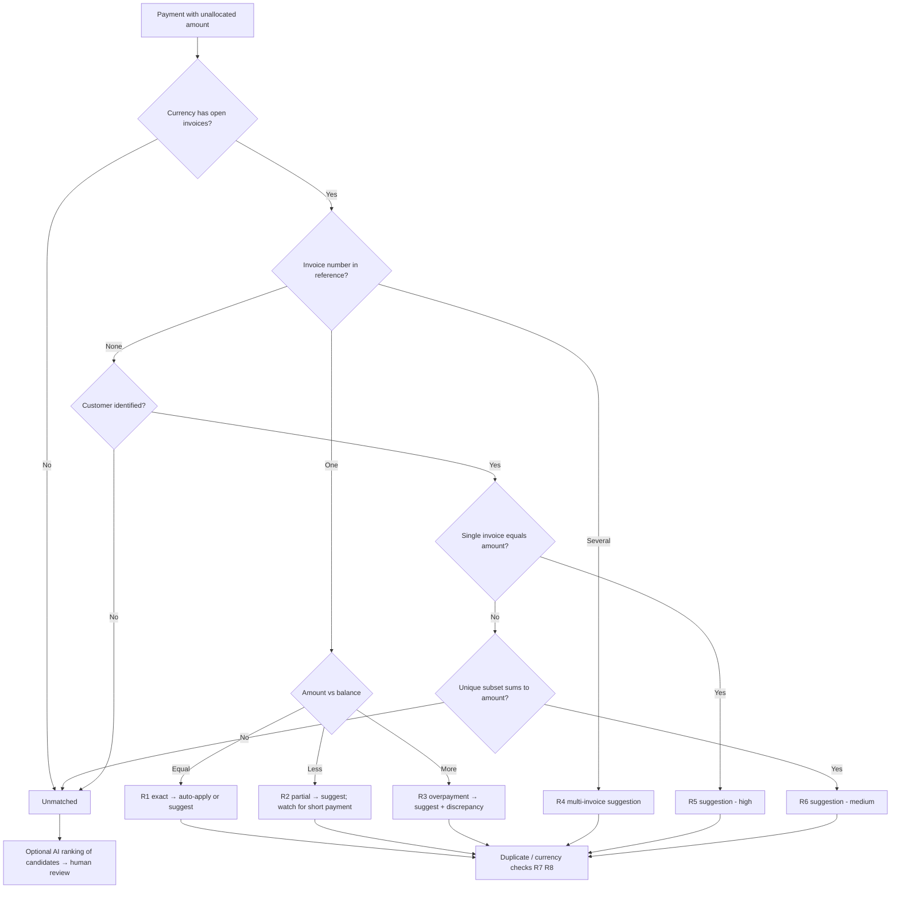

# Venn — Feature Specification

Status: Phase 1 draft · Last updated 2026-11-13

Scope tags: **[M]** MVP · **[P]** post-MVP · **[E]** enterprise. Permission keys refer to [ROLE_PERMISSION_MATRIX.md](ROLE_PERMISSION_MATRIX.md). Screens are in [UI_PAGE_INVENTORY.md](UI_PAGE_INVENTORY.md).

---

## A. Financial business rules (apply to every module)

### A.1 Money
1. Amounts are `Decimal` in Python and `NUMERIC(19,4)` in PostgreSQL. No floats anywhere, including tests and JSON parsing (`parse_float=Decimal`).
2. Amounts cross the API as strings (`"5000.00"`); the frontend formats with `Intl.NumberFormat` and does arithmetic only for display previews using a decimal library. Server totals are authoritative.
3. Every amount has an ISO 4217 currency beside it. Display precision follows the currency (2 for USD, 0 for JPY); storage keeps 4.
4. Rounding: half-even, applied only at defined points (tax per line, display). Never rounded silently on import: a value with more decimals than the currency allows is a validation warning.
5. Negative amounts are not used to mean reversal; reversals, credits and refunds are explicit record types.

### A.2 The invoice balance equation
```
balance_due = total_amount
            − Σ active payment allocations
            − Σ approved adjustments (credit, discount, write-off)
```
- `balance_due ≥ 0` always (database CHECK). An overpayment never makes a balance negative; the excess stays as *unallocated* on the payment.
- `amount_paid` and `balance_due` are stored on the invoice and updated in the same transaction as the allocation/adjustment, under a row lock on the invoice. A nightly integrity job recomputes them from source rows and raises an alert on any difference.

### A.3 Invoice status (challenge C-2)
Stored: `lifecycle_status ∈ {draft, issued, cancelled}`.
Computed:
- `payment_state`: `unpaid` (paid = 0), `partially_paid`, `paid` (balance = 0).
- `is_overdue`: issued, balance > 0, `due_date <` today in the organization's timezone.
- `is_disputed`: has a dispute in a non-terminal status.

Display status, first match wins: **Cancelled → Draft → Paid → Disputed → Overdue → Partially Paid → Issued**. Secondary badges show the others (e.g. *Overdue* with a *Partially paid* chip). Filters work on the underlying flags, so "Overdue" and "Disputed" filters both find an invoice that is both.

### A.4 Payments and allocations
- A payment has `amount`, `allocated_amount`, `unallocated_amount = amount − allocated_amount ≥ 0`.
- Payment status is computed: `unmatched` (allocated = 0), `partially_allocated`, `fully_allocated`; plus stored flags `under_review` and `reversed`.
- An allocation is `(payment, invoice, amount > 0)`, same currency on both sides (CHECK via trigger). Many-to-many.
- Allocations are never edited in place: a change is *void old + create new*, each audited. Voided allocations stay in the table.
- Reversing a payment voids all its allocations and reopens the invoices in one transaction.
- `verification_level`: `source_verified` (bank or gateway import/sync), `manual` (typed by a user), `claimed` is **not** a payment at all; claims live in emails/documents as evidence.

### A.5 Evidence hierarchy
| Tier | Source | Can confirm receipt of money? |
|---|---|---|
| 1 | Bank/gateway transaction (import or sync) | Yes |
| 2 | Accounting-system payment record | Yes, labelled "per accounting system" |
| 3 | Manual payment entry | Shown as unverified until matched to tier 1/2 |
| 4 | Email, remittance advice PDF, customer statement | **No.** Supporting evidence only |

### A.6 Other rules
- **Timezones:** timestamps stored UTC; dates (issue, due, payment date) are calendar dates; "today" and overdue use the organization timezone.
- **Duplicates:** invoice uniqueness is `(organization, customer, invoice_number)` among non-cancelled invoices; payment duplicates are detected by `(source, external_id)` or, for CSV, a row fingerprint (date, amount, currency, reference, payer).
- **No silent overwrite:** re-import of an existing record with different values produces a *conflict* row for review, not an update.
- **Cancelled/void invoices** cannot receive allocations; cancelling requires no active allocations.
- **Credit notes:** modelled as adjustments of type `credit` linked to an invoice (MVP). Standalone customer credit balances are [P].
- **Refunds:** an approved `refund_record` adjustment documents the decision; when a negative/outgoing transaction for it is imported, it is linked and marked verified.
- **Closed periods [P]:** an organization can lock dates before a period end; changes then need approval.
- **Recovery:** see module 11 definition. Not every discrepancy is recoverable; outcomes include `customer_correct` and `no_discrepancy`.

---

## B. Modules

### 1. Authentication and onboarding [M]
- Supabase Auth: email + password (min 12 chars, breached-password check enabled in Supabase), email verification required before any organization data, password reset, session refresh via HTTP-only cookies handled by `@supabase/ssr`.
- MFA (TOTP) available to all users, **required for Owners** before launch (MVP-Complete). **Decision D-09.**
- Onboarding wizard (6 steps, 2–6 skippable). Sample dataset option, labelled "Demo data".
- Acceptance highlights: unverified users get `403 email_not_verified` from the API; signup does not reveal existing emails; invited users never see "Create organization".

### 2. Owner dashboard [M]
KPI definitions (all filterable by date range and currency; each links to a pre-filtered list):

| KPI | Definition |
|---|---|
| Total AR | Σ `balance_due` of issued invoices |
| Outstanding (not yet due) | Σ balance where `due_date ≥ today` |
| Overdue | Σ balance where `is_overdue` |
| Unmatched payments | Count and Σ `unallocated_amount` where > 0 |
| Unresolved discrepancies | Count and Σ exposure of discrepancies not resolved/dismissed |
| Active investigations | Count by status |
| Open disputes | Count and Σ disputed amount |
| Collection performance | Collected on overdue invoices in period ÷ overdue balance at period start (formula shown in a tooltip) |
| Verified recovered | See module 11 |

Panels: aging buckets (current, 1–30, 31–60, 61–90, 90+), outstanding-balance trend (from daily snapshots), overdue by customer (top 10), pending approvals, recent financial activity, investigation summary, integration health.

Multi-currency: KPIs show the organization's default currency; if other currencies exist, a "+ 2 other currencies" control opens a per-currency breakdown. No conversion in MVP.

### 3. AR dashboard [M]
My tasks (due today/overdue), invoices needing attention, unmatched payments, my investigation queue, follow-ups due, my open disputes, my pending requests with status, recent activity. Each list shows the top 5 with "View all".

### 4. Customers [M]
- Fields: name, legal name, external ID, tax ID (optional), billing address, default currency, payment terms (days), status, notes, contacts (name, email, phone, role, is-billing-contact).
- Profile tabs: Overview (balance, overdue, average days to pay, last payment), Invoices, Payments, Disputes, Investigations, Communication (emails linked to the customer), Documents, Activity.
- Risk indicators, computed from records only: average days late (last 12 months), share of invoices paid late, current overdue share, count of broken payment promises. Shown as facts with their basis ("7 of 9 invoices paid late"), never as an opaque score.
- Merge duplicates [P]. Matching aliases (payer names seen on bank lines) are stored per customer and used by reconciliation.

### 5. Invoices [M]
- List: search (number, customer, PO), filters (status flags, customer, date ranges, amount range, currency, has-dispute, has-investigation), sort, saved views [P], bulk export.
- Detail: header facts, line items if present, amounts panel (total, paid, adjustments, balance), related payments with allocations, adjustments, disputes, investigations, documents, communication, history.
- Create/edit: manual form. Editing `total_amount` after issue is blocked when allocations exist; the correct path is an adjustment.
- CSV import: required columns `invoice_number, customer, issue_date, due_date, total_amount, currency`; optional `po_number, description, tax_amount, external_id`. Date format detected and confirmed by the user when ambiguous (03/04/2026).
- PDF extraction: fields + line items + confidence + source snippet per field; user confirms. Low-confidence fields highlighted.

### 6. Payments [M]
- Fields: date, amount, currency, method (bank transfer, card, ACH, cheque, other), reference, payer name as received, customer (nullable), source, external ID, verification level, memo, status flags.
- List filters: status, source, customer, date, amount, has-unallocated.
- Detail: allocations table with add/edit, suggested matches with reasons, evidence, history.
- CSV import: required `date, amount, currency`; optional `reference, payer_name, method, external_id, memo`. Signed-amount handling: user states whether negatives are outgoing; outgoing rows are imported as `direction = out` and excluded from matching except refund linking.

### 7. Reconciliation engine [M]

Deterministic. Runs per payment with `unallocated_amount > 0`. Candidates are issued invoices with balance > 0 in the **same currency**.

| Rule | Condition | Result | Auto-apply? |
|---|---|---|---|
| R1 Exact reference | Normalised reference/memo contains exactly one open invoice number of the org; customer is the same or unknown; amount = balance | Match, confidence **exact** | Yes, if org setting `auto_apply_exact` (default on; **D-06**) |
| R2 Reference, partial | As R1 but amount < balance | Suggested partial allocation; if remainder persists past `short_payment_grace_days` (default 7) → `short_payment` discrepancy | No |
| R3 Reference, over | As R1 but amount > balance | Suggest allocate up to balance; remainder unallocated; `overpayment` discrepancy | No |
| R4 Multi-reference | Reference lists several invoice numbers and amount = Σ balances | Suggested multi-invoice allocation, confidence **high** | No |
| R5 Customer + amount | Customer known (by ID or alias), exactly one open invoice with balance = amount | Suggestion, confidence **high** | No |
| R6 Customer + combination | Customer known; a unique subset of ≤ 6 open invoices sums to amount (search capped, oldest-first tie-break never auto-selected) | Suggestion, confidence **medium** | No |
| R7 Duplicate | Same customer, amount and reference as another payment within 14 days, or reference points to an already paid invoice | `duplicate_payment` discrepancy; payment set `under_review` | No |
| R8 Currency mismatch | Reference identifies an invoice in a different currency | `currency_mismatch` discrepancy | No |
| — | Nothing above | Stays **unmatched**; payer-name similarity (trigram) proposes customers | No |

Further detections (scheduled, not per payment):
- `missing_payment_claimed`: an email or document classified as a payment claim for an invoice, and no source-verified payment within `claim_grace_business_days` (default 5).
- `misallocation`: an active allocation where the payment's reference names a different invoice.
- `duplicate_invoice`: two non-cancelled invoices, same customer, amount and PO or dates within 3 days with similar numbers.

AI assistance [M-Complete]: for unmatched payments and medium suggestions, a model may rank the deterministic candidate set and write a one-line rationale citing fields. It cannot add candidates outside the set and cannot apply anything.



Reconciliation workspace: tabs *Needs review*, *Unmatched*, *Auto-applied* (with undo), *Discrepancies*; run history with counts; each suggestion shows "why" in plain language.

### 8. Venn Investigation Workspace [M] — flagship

Opened from a discrepancy (automatically for `short_payment`, `duplicate_payment`, `missing_payment_claimed`, `overpayment`; manually for anything).

| Section | Content | Source of truth |
|---|---|---|
| Overview | ID (`INVG-0001`), customer, invoice(s), discrepancy type, exposure, priority, status, assignee, created | Records |
| What happened? | 2–5 sentence narrative | AI, every sentence tied to evidence IDs |
| Evidence | Invoices, payments, documents (page-level), emails, attachments, customer facts, notes; each with source link, tier (A.5) and "used in findings" marker | Stored evidence rows |
| Findings | Five lists: **Confirmed facts**, **Possible explanations**, **Unverified claims**, **Missing evidence**, **Calculations** | Facts and calculations from deterministic code; explanations from AI with citations |
| Recommendation | One primary action + alternatives, each with rationale and required permission/approval | AI proposes from a fixed action catalog |
| Approval | Approve, reject, request more evidence, assign, internal note | Approval service |
| Resolution | Approved action, action taken, outcome, updated records, remaining balance, resolution date | Records; verified amounts from allocations |

Action catalog (closed list; AI can only choose from it): `request_proof_of_payment`, `contact_customer_balance_due`, `review_contract_terms`, `correct_allocation`, `prepare_dispute_response`, `propose_credit`, `propose_write_off`, `record_refund_due`, `escalate_to_owner`, `no_action_monitor`, `dismiss_not_discrepancy`.

Priority: `critical / high / medium / low` from exposure relative to the org's median invoice and age; user-overridable.

Behaviour
- Analysis is versioned; re-running keeps prior versions. Human notes are never overwritten.
- If the AI step fails or is disabled, the workspace still works: evidence, deterministic facts and calculations are present and the user writes the narrative and picks the action.
- Recovery is shown only as "Verified: 1,000.00 received on 2026-11-20 (payment PAY-0231)" once a source-verified payment is allocated.

### 9. Collections [M-Complete]
- Case per overdue invoice, grouped by customer in the queue. Fields: stage (`reminder_1`, `reminder_2`, `final_notice`, `escalated`, `paused`, `closed`), next action date, owner, promise-to-pay date and amount.
- Priority score (deterministic, explained on hover): balance × days overdue weight + broken-promise weight; disputed invoices are paused.
- Drafts: generated from a template + record facts + last communications. Tone presets (friendly, firm, final). The draft shows which facts were inserted. Model may not invent amounts, dates, fees or legal consequences; a post-generation check verifies every amount/date/invoice number in the draft exists in the case facts.
- Sending: through the connected mailbox as the user/organization; without a mailbox, "copy and mark sent".
- Scheduling: one follow-up date per case [M]; multi-step cadences [P].
- Timeline: sent, received (linked emails), notes, promises, status changes.

### 10. Disputes [M-Complete]
- Categories: pricing, quantity/hours, quality/service, duplicate billing, missing PO, not received, tax, payment already made, other.
- Fields: invoice, disputed amount (≤ invoice total), customer explanation, category, assignee, status, due date, resolution (`upheld`, `partially_upheld`, `rejected`), resolution note, linked adjustment.
- Evidence and timeline components are shared with investigations. A dispute can be created from an investigation and vice versa; they link, they do not merge.
- Dispute Analysis assistance [P]: summarise both positions with citations.

### 11. Approval Center [M]
- Queue with filters (type, requester, amount, age). Detail: requester, reason, financial impact (before/after balance), evidence, record link, history.
- Decisions: approve, reject (reason required), request more information. Decisions are immutable.
- Requester view ("My requests"): status, decision, comments; can withdraw while pending.
- Staleness check on execution (see USER_FLOWS §7). Expiry after 30 days pending (configurable).

**Verified recovered amount (definition)**
```
Σ allocation.amount
where allocation.payment.verification_level = source_verified
  and allocation.payment.date ≥ first Venn action date on the invoice
  and the invoice has a linked investigation or collection case
      whose first action preceded the payment
```
Shown with its component rows. Labelled "Verified recovered — payments received after Venn activity", which describes correlation, not proof that Venn caused the payment.

### 12. Analytics and reports [M-Complete]
Reports: receivables aging (as-of date), outstanding balance trend, overdue trend, collection effectiveness, reconciliation performance (auto/suggested/manual share, time to match), discrepancy categories (count, exposure), investigation resolution time (median, by type), verified recovered, customer payment behaviour.
- Every chart has the table behind it and a drill-down to records. CSV export respects filters, is permission-checked and audit-logged.
- Trend data comes from a `daily_ar_snapshots` table written by a nightly job, so history does not change when records are edited later.
- No AI-generated numbers. A natural-language "ask" feature is [P] and would only generate filter parameters for these fixed reports.

### 13. Integrations [M → P]
Integration Center cards by category. Each shows: status (`not_connected`, `connecting`, `connected`, `needs_attention`, `error`, `coming_soon`), connected account, granted scopes in plain language, last successful sync, last error, sync now, disconnect.

| Integration | Stage | Direction | Scopes / access (minimum) |
|---|---|---|---|
| CSV, PDF, manual | MVP-Core | In | — |
| Gmail | MVP-Complete | Read + send | `gmail.readonly` (restricted scope) and `gmail.send`; label/query filter to financial mail |
| QuickBooks Online | MVP-Complete | Read | `com.intuit.quickbooks.accounting` |
| Stripe | MVP-Complete | Read | Connect OAuth read-only or restricted key (read charges, payouts, refunds, customers, invoices) |
| Outlook (Microsoft Graph) | Post-MVP | Read + send | `Mail.Read`, `Mail.Send`, `offline_access` |
| Xero | Post-MVP | Read | accounting read scopes |
| Bank feeds | Post-MVP | Read | Via aggregator |

"Coming soon" cards are visibly disabled. A connection is `connected` only after a real successful API call. Disconnect revokes the token at the provider where supported and deletes stored tokens; synced data retention on disconnect is the user's choice (keep / delete).

### 14. Team management [M]
Members table (name, email, role, status, last active), pending invitations (resend, revoke), invite dialog, member detail (role, configurable permissions, suspend/reactivate, activity). Role permission editor for the AR Specialist role with locked items shown as locked.

### 15. Audit log [M]
- Events: auth (login success/failure via Supabase hooks where available, password reset, MFA changes), membership and permission changes, all financial creates/updates/voids, allocations, imports, investigation status and action changes, approval requests and decisions, email sends, integration connect/disconnect/sync failure, settings changes, exports.
- Entry: id, time (UTC), actor (user or `system`/job), organization, action key, record type and id, before/after (JSONB, sensitive fields redacted), request id, IP, user agent, previous-entry hash and own hash.
- Append-only: the application DB role has INSERT and SELECT only; a trigger rejects UPDATE/DELETE.
- Viewer: filters, entry detail, CSV export (Owner).

### 16. Organization settings [M]
Tabs: Company profile · Financial preferences (default currency, timezone, default payment terms, grace periods, auto-apply exact matches) · Approval policies · Notifications · Roles & permissions · Remittance details · Security (MFA requirement, sessions) · Data (export, delete organization — delete is [P] self-serve; MVP via support request).

### 17. Notifications and tasks [M]
- In-app bell: approval requested/decided, assignment, mention in a note, import finished/failed, integration needs attention, follow-up due.
- Email notifications for approvals and assignments [M-Complete], per-user preferences.
- Tasks: lightweight (`title`, `due_date`, `assignee`, linked record, status), created by users or by the system (follow-up dates, missing-evidence requests).

### 18. Documents and email intelligence [M-Core: documents · M-Complete: email]
- Documents: upload PDF/PNG/JPG/CSV ≤ 20 MB; MIME sniffing + extension check; malware scan; stored privately; text layer extracted, OCR fallback; chunks embedded (pgvector) for retrieval inside the same organization only; types: invoice, contract, purchase order, remittance advice, statement, other.
- Email: sync only messages matching a financial filter (from/to known customer contact addresses or domains, or containing invoice numbers / finance keywords); store headers, snippet, body text, provider message ID and thread ID, attachment metadata; classify (`payment_claim`, `remittance_advice`, `dispute`, `promise_to_pay`, `invoice_query`, `other`); extract invoice numbers, amounts, dates, references; link to customer/invoice with a confidence; uncertain links go to a review list.
- An email classified `payment_claim` creates **evidence** and may trigger `missing_payment_claimed`. It never creates a payment.

### 19. Public website [M-Complete]
Routes and sections are specified in UI_PAGE_INVENTORY. Rules: no testimonials, logos or statistics unless real and permitted; security page states only controls that exist; pricing page shows "Contact us / early access" until pricing is approved (**D-08**); legal pages need counsel review before launch (**D-13**).
