# venn: module delivery plan (Phase 3, end to end)

Status: **awaiting owner approval** · Last updated 2026-11-15

This plan builds the 21 modules in [docs/modules](../modules/README.md) from the approved frontend to a deployed product: database, API, background jobs, AI, integrations, and the frontend switched from browser storage to the API. It follows the milestone order already agreed in [DEVELOPMENT_ROADMAP.md](DEVELOPMENT_ROADMAP.md) (M4–M17) and makes each milestone concrete per module, with checkpoints you approve.

Nothing in this plan starts until you approve it. After that, each **gate** (◆) stops for your approval before the next stage begins.

---

## 1. Decisions needed before Stage A

| ID | Decision | Recommendation | Why |
|---|---|---|---|
| P3-D1 | Frontend framework. Architecture names Next.js; the approved, tested frontend is Vite + React Router. | **Keep Vite + React Router.** Pre-render the marketing routes at build time for SEO. | Rewriting 8,000 tested lines buys nothing the product needs; the app is behind login, where server rendering adds little. |
| P3-D2 | Backend stack | **As planned:** FastAPI, SQLAlchemy 2, PostgreSQL 16 + pgvector (Supabase), Alembic, Celery + Redis, Supabase Auth | Already designed in SYSTEM_ARCHITECTURE and DATABASE_DESIGN. |
| P3-D3 | Hosting (open item D-02) | Web: Cloudflare Pages or Vercel (static). API + worker: Fly.io or Render containers. Database/auth/storage: Supabase. Redis: Upstash. | Cheap at MVP scale, no server management, all have free/low tiers for staging. |
| P3-D4 | AI provider | Anthropic Claude (`claude-sonnet-5-5` for analysis, `claude-haiku-5-5` for classification); embeddings from one provider behind an adapter | Strong tool use and citation behaviour; the adapter keeps it swappable. |
| P3-D5 | Password minimum | 12 characters (spec) instead of the prototype's 10 | Matches FEATURE_SPECIFICATION and current guidance. |
| P3-D6 | Sample workspace | Each `/demo` visitor gets an isolated sandbox organization, deleted after 7 days; the "view as" role switcher exists only there | Lets the public try the product without touching real data. |
| P3-D7 | Git workflow | Short-lived branch per checkpoint, small commits (one per FR or test group), merged into `main` with `--no-ff` so the graph shows each checkpoint; CI must pass before merge | Keeps a dense, readable history and a green `main`. |

---

## 2. What you need to provide, and when

| Needed by | Item |
|---|---|
| Stage A | Supabase project (free tier is fine for development) |
| Stage E | LLM API key (Anthropic) and an embeddings key |
| Stage G | Google Cloud project with OAuth consent screen (Gmail); Intuit developer account (QuickBooks); Stripe account (test mode first) |
| Stage J | Hosting accounts (per P3-D3), a domain, an SMTP provider (e.g. Postmark or Resend), an error tracker (e.g. Sentry) |

Stages A–D need nothing external except Supabase, so most of the build can be verified with no third-party accounts.

---

## 3. Stage overview

```mermaid
flowchart LR
  A[A Foundation] --> B[B Identity, tenancy, audit] --> C[C Core ledger]
  C --> D[D Reconciliation, approvals] --> E[E Documents, investigations, AI]
  E --> F[F Collections, disputes, notifications] --> G[G Email and integrations]
  G --> H[H Dashboards and analytics] --> I[I Hardening and website] --> J[J Launch readiness]
```

| Stage | Roadmap | Modules | Size | Gate |
|---|---|---|---|---|
| A Foundation | M4 | cross-cutting, MOD-04 (part) | M | ◆ A |
| B Identity, tenancy, audit | M5 | MOD-02, 03, 18, 19, 20 (company, security, profile) | L | ◆ B |
| C Core ledger | M6–M8 | MOD-04, 06, 07, 08, 09 (CSV) | L | ◆ C |
| D Reconciliation and approvals | M9–M10 | MOD-10, 12, 20 (financial, approvals) | L | ◆ D |
| E Documents, investigations, AI | M11 | MOD-16 (documents), 09 (PDF), 11 | XL | ◆ E: vertical slice |
| F Collections, disputes, notifications | M12 | MOD-13, 14, 21 | M | ◆ F |
| G Email and integrations | M13, M15 | MOD-17, 16 (email) | L | ◆ G |
| H Dashboards and analytics | M14 | MOD-05, 15 | M | ◆ H |
| I Hardening and website | M16 | MOD-01, all (NFRs) | M | ◆ I |
| J Launch readiness | M17 | all | M | ◆ J: go-live |

Sizes from the roadmap: S ≈ up to 1 week, M ≈ 1–2 weeks, L ≈ 2–4 weeks, XL ≈ 4+ weeks of focused work. They are relative, not promises.

---

## 4. How every module is built (the per-module recipe)

Each module goes through the same steps, so the frontend never breaks while the backend arrives:

1. **Schema** – Alembic migration for the module's tables with `organization_id`, composite foreign keys, forced RLS, `version` column, indexes (DATABASE_DESIGN).
2. **Domain services** – pure functions over `Decimal` with unit and property tests (money, balances, rules).
3. **API** – routers per API_SPECIFICATION with permission checks, idempotency keys, `If-Match`, RFC 9457 errors, audit in the same transaction.
4. **API tests** – integration tests against real Postgres; RBAC matrix rows; cross-tenant cases; audit assertions.
5. **OpenAPI → TypeScript types** – regenerate `apps/web/src/types/api.ts`; CI fails on drift.
6. **Frontend switch** – replace the module's `store.ts` actions with TanStack Query hooks (`features/<module>/api.ts`) calling `api/http.ts`. Screens keep their markup; only data sources change. Add loading, error (with request ID) and permission states.
7. **Component tests** with MSW for each state; **Playwright** test for each module use case; **axe** on each route.
8. **Close the module's gaps** listed in its spec file (status Partial/None).
9. **Checkpoint evidence** in `docs/testing/checkpoints/<CP-id>.md` (commands run, results, AC pass/fail, screenshots at 1440 and 390, open issues), and `docs/PROJECT_STATUS.md` updated.

A module is **done** when every Must FR is implemented, every listed test case passes, global criteria G-1…G-10 hold, and its use cases pass end to end against the API.

---

## 5. Stages and checkpoints

### Stage A — Foundation (M4)

| CP | Goal | Deliverables | Exit evidence |
|---|---|---|---|
| A1 | Backend skeleton | `services/api` (FastAPI, settings, logging with request IDs, health endpoint, RFC 9457 errors), Postgres + pgvector + Redis + Mailpit in Docker Compose, Alembic baseline | `docker compose up` → `/health` 200; pytest green |
| A2 | CI for both apps | GitHub Actions: Ruff, mypy, pytest with Postgres service, web lint/typecheck/tests/build, gitleaks, `npm audit`, `pip-audit` | CI green on `main` |
| A3 | Frontend data layer | TanStack Query, typed client from OpenAPI, MSW test setup, Playwright + axe harness, `features/` folders, money formatting with a decimal library | Example query against `/health`; first Playwright and axe runs in CI |
| A4 | Shared UI from MOD-04 gaps | URL-synced table state, server-pagination mode for DataTable, API error toast with request ID | Component tests for each |

◆ **Gate A:** environments run locally and in CI; you confirm P3-D1…D7.

### Stage B — Identity, tenancy, audit (M5)

| CP | Goal | Modules / FRs | Exit evidence |
|---|---|---|---|
| B1 | Tenancy and RBAC core | `organizations`, `memberships`, `role_permissions`; JWT verification via JWKS; `X-Organization-Id` check; RLS with `SET LOCAL`; `require_permission` | Cross-tenant suite and RBAC matrix test running (G-2, G-3, G-6) |
| B2 | Audit foundation | MOD-19 FR-01…03, hash chain, append-only grants, viewer API | TC-19-01…04 pass |
| B3 | Auth in the frontend | MOD-02 all Must FRs: Supabase sign-up/verify/sign-in/reset/sign-out, 12-char policy, lockout, return path, session-expired; `localAuth.ts` replaced behind the same interface | TC-02-01…12 pass |
| B4 | Onboarding and sandbox | MOD-03 FR-01…06, 09; sandbox organizations for `/demo` (P3-D6); role switcher only in sandbox (FR-02-12) | TC-03-01…08 pass |
| B5 | Team, settings, profile | MOD-18 all Must FRs; MOD-20 company, security, profile; MOD-19 viewer wired | TC-18-*, TC-20-01…02, TC-20-04, TC-19-05 pass |

◆ **Gate B:** you sign up, verify, onboard, invite an AR user, change their role, see every step in the audit log, and confirm an AR cannot reach Owner screens or APIs.

### Stage C — Core ledger (M6–M8)

| CP | Goal | Modules / FRs | Exit evidence |
|---|---|---|---|
| C1 | Shell on real data | MOD-04 FR-02, 03 (server search), 06, 08, 10; navigation counts | TC-04-* pass |
| C2 | Customers | MOD-06 all Must FRs incl. uniqueness and stats with basis | TC-06-* pass |
| C3 | Invoices | MOD-07 all Must FRs incl. status precedence, timezone overdue, cancel blocked with allocations, currency on every amount | TC-07-* pass incl. concurrency TC-07-10 |
| C4 | Payments and allocations | MOD-08 all Must FRs incl. verification level, reversal reason, currency check, lock ordering | TC-08-* pass incl. property and concurrency tests |
| C5 | CSV import | MOD-09 FR-01…09 incl. column mapping and database duplicate detection, import jobs | TC-09-01…07, 09 pass; 10k-row benchmark recorded |

◆ **Gate C:** you import your own invoice and payment CSVs, allocate payments, void and reverse, and see balances, statuses and audit entries match by hand calculation.

### Stage D — Reconciliation and approvals (M9–M10)

| CP | Goal | Modules / FRs | Exit evidence |
|---|---|---|---|
| D1 | Rule engine | MOD-10 FR-01, 02, 06, 08: R1–R8 and scheduled detections as pure services | TC-10-01…09 and golden files pass; determinism test |
| D2 | Reconciliation workspace | MOD-10 FR-03…05, 07; runs as jobs; keyboard review | TC-10-10…13 pass; 10k-payment benchmark |
| D3 | Approvals and adjustments | MOD-12 all Must FRs incl. separation of duties, staleness, idempotent decisions; MOD-20 financial and approvals tabs | TC-12-*, TC-20-03 pass |

◆ **Gate D:** you run reconciliation on your data, review suggestions with the keyboard, undo an auto-match, request and approve a write-off, and see a self-approval refused.

### Stage E — Documents, investigations and AI (M11) — the vertical slice

| CP | Goal | Modules / FRs | Exit evidence |
|---|---|---|---|
| E1 | Documents | MOD-16 FR-01…06: 20 MB uploads, sniffing, malware scan, private storage with signed URLs, extraction and OCR, embeddings | TC-16-01…05 pass |
| E2 | PDF review | MOD-09 FR-10 on real extraction | TC-09-08 pass |
| E3 | Investigations without AI | MOD-11 FR-01, 02, 04, 07, 09…12: auto-open from discrepancies, board/table, evidence tiers, deterministic facts and calculations, versioning, stale detection | TC-11-01, 02, 08…10 pass |
| E4 | AI analysis | MOD-11 FR-03, 05, 06, 08 with LangGraph: cited findings only, closed action catalog, failure and insufficient-evidence paths, prompt/model versions stored | TC-11-03…07, 11 pass; AI evaluation suites meet AI_AGENT_ARCHITECTURE thresholds |

◆ **Gate E (vertical slice):** with your data: import → discrepancy detected → investigation opened → evidence attached → AI findings with citations → recommendation → approval → action → verified outcome when the payment arrives.

### Stage F — Collections, disputes, notifications (M12)

| CP | Goal | Modules / FRs | Exit evidence |
|---|---|---|---|
| F1 | Notifications and tasks | MOD-21 all Must FRs via the outbox | TC-21-* pass |
| F2 | Collections | MOD-13 all Must FRs with "copy and mark sent" (live sending in G); fact-check validator | TC-13-* pass (TC-13-08 with fake mail provider) |
| F3 | Disputes | MOD-14 all Must FRs incl. pausing collections and credit via approval; outcome model per its gap note | TC-14-* pass |

◆ **Gate F:** you run a collection from reminder to promise to payment, open and resolve a dispute with a credit, and receive the right notifications.

### Stage G — Email and integrations (M13, M15)

| CP | Goal | Modules / FRs | Exit evidence |
|---|---|---|---|
| G1 | Integration framework | MOD-17 FR-01…05, 07…09: OAuth, encrypted tokens, verified connect, disconnect with revoke | TC-17-01…04, 06 pass |
| G2 | Gmail | MOD-16 FR-07…09; MOD-13 live sending | TC-16-06, 07 pass; Google OAuth verification submitted |
| G3 | Stripe and QuickBooks (read) | MOD-17 FR-06 sync jobs feeding MOD-09 rules | TC-17-05 pass on test accounts |

◆ **Gate G:** you connect Gmail, Stripe (test) and QuickBooks (sandbox); emails link to customers; a claim email creates evidence but no payment; a Stripe charge reconciles.

### Stage H — Dashboards and analytics (M14)

| CP | Goal | Modules / FRs | Exit evidence |
|---|---|---|---|
| H1 | Snapshots | `daily_ar_snapshots` nightly job and backfill | Job tests; history stable after edits (TC-15-05) |
| H2 | Dashboards | MOD-05 all Must FRs on real aggregates, 5 aging buckets, multi-currency breakdown (Should) | TC-05-* pass; p95 ≤ 800 ms |
| H3 | Reports | MOD-15 all Must FRs incl. audited exports and verified-recovered formula | TC-15-* pass |

◆ **Gate H:** every dashboard and report number on your data reconciles to the underlying records.

### Stage I — Hardening and website (M16)

| CP | Goal | Scope | Exit evidence |
|---|---|---|---|
| I1 | Website | MOD-01 FR-05…10: lead endpoint, rate limits, pre-rendering, sitemap, robots; testimonial confirmation | TC-01-* pass; Lighthouse budget met |
| I2 | Performance | NFR-G-08 on a seeded 100k-invoice organization | k6 report; bundle budget |
| I3 | Security | ZAP baseline, dependency and container scans, CSP, cookie flags, rate limits, secrets review | Reports with no high findings |
| I4 | Accessibility and browsers | axe on all routes, manual keyboard pass per module, contrast check, Chromium/Firefox/WebKit | 0 serious/critical; checklist signed |

◆ **Gate I:** you review the reports and the final visual pass against `design-v2`.

### Stage J — Launch readiness (M17)

| CP | Goal | Scope | Exit evidence |
|---|---|---|---|
| J1 | Staging | Full stack on the chosen hosts; migrations as a release step; seeded sandbox | Smoke tests green on staging |
| J2 | End-to-end scenarios | ACCEPTANCE_CRITERIA scenarios A–J in Playwright against staging | All pass |
| J3 | Operations | Backups and restore drill, monitoring and alerts, error tracking, runbooks, incident contacts, legal pages reviewed (D-13) | Restore drill recorded; runbooks in `docs/deployment` |
| J4 | Production | Production deploy, DNS, SMTP, OAuth production credentials | Smoke test on production |

◆ **Gate J (go-live):** you approve launch.

---

## 6. Module → checkpoint traceability

| Module | Checkpoints |
|---|---|
| MOD-01 Public website | I1 |
| MOD-02 Identity and access | B1, B3, B4 |
| MOD-03 Onboarding | B4 |
| MOD-04 App shell | A4, C1 |
| MOD-05 Dashboards | H2 |
| MOD-06 Customers | C2 |
| MOD-07 Invoices | C3 |
| MOD-08 Payments and allocations | C4 |
| MOD-09 Data import | C5, E2 |
| MOD-10 Reconciliation | D1, D2 |
| MOD-11 Investigations | E3, E4 |
| MOD-12 Approvals and adjustments | D3 |
| MOD-13 Collections | F2, G2 |
| MOD-14 Disputes | F3 |
| MOD-15 Analytics and reports | H1, H3 |
| MOD-16 Documents and email | E1, G2 |
| MOD-17 Integrations | G1, G3 |
| MOD-18 Team and permissions | B5 |
| MOD-19 Audit log | B2, B5 |
| MOD-20 Settings and profile | B5, D3 |
| MOD-21 Notifications and tasks | F1 |

---

## 7. Quality bar at every checkpoint

- Global criteria G-1…G-10 from ACCEPTANCE_CRITERIA, and the global NFRs in [docs/modules/README.md](../modules/README.md).
- Tests are written with the code, not after. Nothing is reported as passing without the command output in the evidence file; anything that cannot be verified is reported BLOCKED with the reason.
- Each checkpoint is merged to `main` only with green CI; commits stay small and descriptive.

## 8. Main risks

| Risk | Effect | Mitigation |
|---|---|---|
| Google OAuth verification for restricted Gmail scopes takes weeks | Stage G slips | Submit at the start of Stage E; F works without live email |
| AI findings cite poorly on real documents | Flagship quality | Deterministic facts first (E3); evaluation thresholds gate E4; manual mode always works |
| Real CSV exports vary widely | Import friction | Column mapping and date-format confirmation in C5; collect 3 real samples before C5 |
| Performance at 100k invoices | Slow lists and dashboards | Indexes and server pagination from Stage C; snapshots in H1; k6 in I2 |
| Scope growth | Delay | Should/Could FRs only after the stage's Must FRs pass |

---

**Approval requested:** decisions P3-D1…D7 (section 1), the stage order and gates (sections 3 and 5), and the per-module recipe (section 4). On approval, work starts at checkpoint A1.
