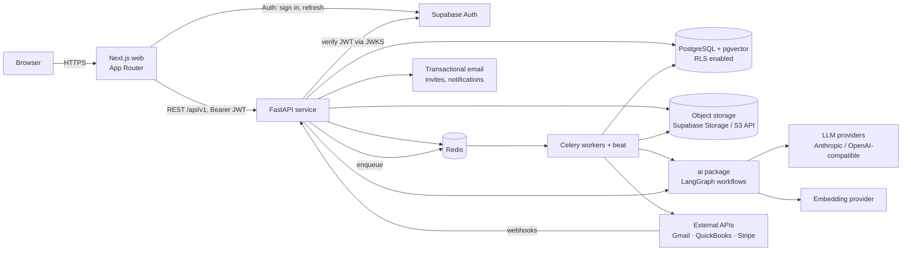
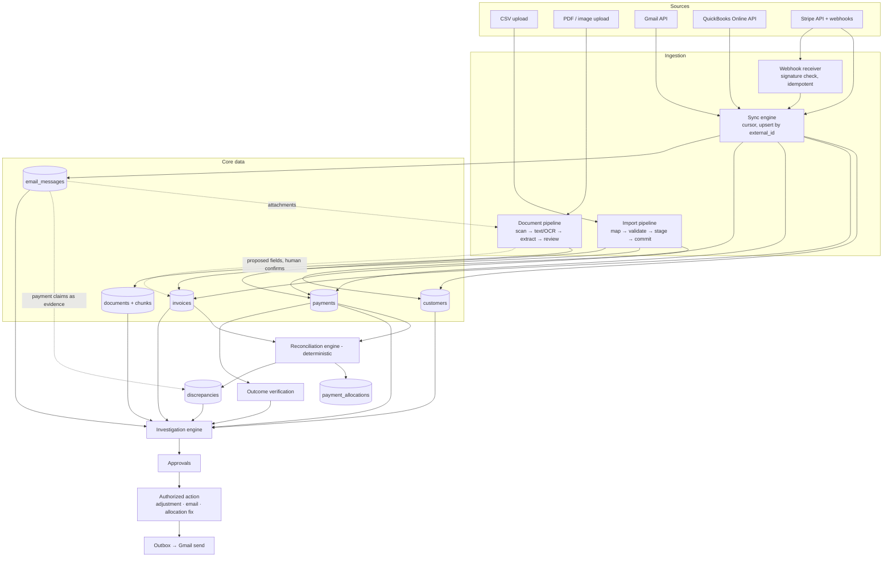

# Venn — System Architecture

Status: Phase 1 draft · Last updated 2026-11-13

This document was added to the required set to hold the overall architecture, frontend/backend structure, integration architecture and repository layout in one place.

## 1. Overview

A **modular monolith**: one Next.js web app, one FastAPI service, one Celery worker pool, PostgreSQL (with pgvector), Redis, object storage. No microservices.



### Responsibilities

| Component | Does | Does not |
|---|---|---|
| Next.js web | Rendering, forms, client cache, session cookies, calling the API | Business rules, authorization decisions, direct database access |
| FastAPI | Authentication verification, tenant context, permissions, all business logic, transactions, audit | Long-running work (delegates to workers) |
| Workers | Imports, reconciliation runs, document extraction, AI analysis, sync, scheduled jobs | Serving requests |
| `ai` package | LLM workflows with typed inputs/outputs and read-only tools | Writing financial data, arithmetic that is shown as fact |
| PostgreSQL | Source of truth, constraints, RLS | — |
| Redis | Celery broker/result, rate-limit counters, short-lived locks | Durable data |

## 2. Key decisions

| # | Decision | Why | Alternatives rejected |
|---|---|---|---|
| A-1 | The browser talks to Supabase only for **auth**; all data goes through FastAPI | One place for permissions, policies, audit and money rules | Supabase client-side data access: splits business logic between RLS and Python |
| A-2 | FastAPI verifies Supabase JWTs (asymmetric keys via JWKS, cached), then loads membership and permissions **from the database on every request** | Suspension and role changes take effect immediately; nothing sensitive trusted from the token or the client | Custom claims in the JWT: stale until refresh |
| A-3 | Active organization is sent as `X-Organization-Id` and **verified** against the caller's active membership | Supports multi-org users; client value is a selector, never an authority | Org in path: noisier URLs; org in token: stale |
| A-4 | Tenant isolation is enforced twice: repository base class always filters by `organization_id`, and PostgreSQL RLS with `SET LOCAL app.org_id` per transaction, using a non-owner DB role | A missed filter in code cannot leak across tenants | Code-only: one bug away from a breach. RLS-only: harder to test and reason about |
| A-5 | Financial logic lives in `services/` as pure, typed functions over `Decimal`; AI code cannot import the write side | Keeps accounting deterministic and testable | Letting graphs call repositories directly |
| A-6 | Background jobs are idempotent and tracked in `background_jobs`; the UI polls job status (SSE later if needed) | Simple, robust, works behind any proxy | WebSockets: unnecessary in MVP |
| A-7 | Outbox pattern for side effects (emails, notifications, enqueueing follow-up jobs): rows written in the business transaction, dispatched by a worker | A sent email and its audit/timeline record cannot diverge | Sending inside the request |
| A-8 | Single region, single database; storage behind an S3-compatible interface | MVP simplicity; portability off Supabase Storage | — |
| A-9 | App tables live in the `public` schema of the same Postgres as Supabase Auth; `profiles.id` references `auth.users(id)` | One transactional database | Separate DBs: cross-DB consistency problems |
| A-10 | UUIDv7 primary keys; human-readable per-organization numbers (`INVG-0001`, `PAY-0231`, `DSP-0007`) from a per-org sequence table | Sortable keys, friendly references | Serial IDs: leak volume across tenants |

## 3. Frontend architecture

- Next.js App Router, React, TypeScript `strict`, Tailwind, shadcn/ui, Lucide, React Hook Form + Zod, TanStack Query, Recharts.
- Route groups: `(marketing)` static/ISR Server Components; `(auth)`; `(onboarding)`; `(app)` authenticated shell.
- **Server Components** for marketing pages, layouts and the first paint of read-heavy pages. **Client Components** for tables with filters, forms, the reconciliation review and investigation workspace.
- Session: `@supabase/ssr` with HTTP-only cookies; middleware refreshes the session and redirects unauthenticated users from `/app`.
- API access: a typed client generated from the FastAPI OpenAPI schema (`openapi-typescript`), so request/response types cannot drift. A thin fetch wrapper adds the bearer token, `X-Organization-Id`, `Idempotency-Key` for mutations, and normalises errors.
- State: server state in TanStack Query (query-key factory per feature); URL holds filters/sort/pagination; no global client store unless a need appears.
- Permissions: `useMe()` → `can("permission.key")`; a `<Can>` wrapper for UI. Purely cosmetic; the API decides.
- Money: `formatMoney(amountString, currency)`; a small decimal library for input previews; never `parseFloat`.
- Feature folders: `features/<domain>/{api,components,hooks,schemas}`; shared primitives in `components/ui`.

## 4. Backend architecture

Layers, one direction only:

```
api (routers, request/response schemas, dependencies)
  → services (use cases, policies, transactions, audit)
    → repositories (tenant-scoped data access)
      → models (SQLAlchemy 2.x typed ORM)
core (config, security, db session, errors, logging)  ← used by all
integrations (provider clients behind interfaces)      ← used by services and workers
```

- **Request pipeline (dependencies):** request ID → authenticate (JWT) → resolve organization and membership → load permissions → open DB session and `SET LOCAL app.org_id / app.user_id` → route → `require_permission` → service.
- **Transactions:** one unit of work per request/job. Financial writes take `SELECT … FOR UPDATE` on the affected invoice/payment rows in a fixed order (payment, then invoices by ID) to avoid deadlocks.
- **Audit:** `audit.record(action, record, before, after)` is called inside services and written in the same transaction.
- **Errors:** domain exceptions map to RFC 9457 problem responses with stable `code` values.
- **Idempotency:** `Idempotency-Key` header stored with the response hash per organization; replays return the stored response.
- **Concurrency:** rows carry `version`; updates use `If-Match`/version check → `409 version_conflict`.
- **Configuration:** `pydantic-settings` from environment; no secrets in the repository; `.env.example` documents every variable.
- **Async:** FastAPI async endpoints with SQLAlchemy async engine (asyncpg); Celery tasks use a sync engine (psycopg). Shared service code is written to accept a session and stays I/O-thin so both can use it. *Simplification option at M4: sync endpoints everywhere if dual drivers prove costly.*

### Modules (bounded contexts inside the monolith)

`identity` (profiles, orgs, memberships, invitations, roles) · `customers` · `invoicing` · `payments` (incl. allocations) · `reconciliation` · `investigations` · `collections` · `disputes` · `approvals` · `adjustments` · `documents` · `email` · `integrations` · `analytics` · `notifications` · `audit` · `imports` · `jobs`.

Rule: a module calls another module's **service interface**, never its tables.

## 5. Background processing

| Queue | Tasks | Notes |
|---|---|---|
| `imports` | CSV parse/validate/insert | Chunked; progress in `background_jobs` |
| `recon` | Reconciliation runs, scheduled detections | One run per organization at a time (Redis lock + DB advisory lock) |
| `documents` | Text extraction, OCR, chunking, embeddings | CPU-heavy; separate concurrency |
| `ai` | Investigation analysis, extraction, drafting | Rate-limited per organization; cost-capped |
| `sync` | Gmail, QuickBooks, Stripe incremental sync | Cursor-based, backoff on 429 |
| `default` | Outbox dispatch, notifications, snapshots | — |

Celery beat schedule: nightly AR snapshot, overdue/collection case refresh, balance integrity check, claim-grace detection, approval expiry, token refresh, integration health check.

Task rules: idempotent, `acks_late`, bounded retries with exponential backoff and jitter, hard time limits, dead-letter recording in `background_jobs` with error detail (no payloads with financial content in logs).

## 6. Integration architecture and data flow



Common integration contract (`integrations/base.py`): `authorize_url()`, `exchange_code()`, `refresh()`, `revoke()`, `test_connection()`, `sync(cursor) → (records, next_cursor)`. Each provider maps external objects to Venn's canonical schemas; every synced row stores `source`, `external_id` and a `raw` JSONB snapshot.

Sync rules: upsert on `(organization_id, source, external_id)`; a change to an already-allocated record creates a **conflict** for review instead of overwriting amounts; deletions upstream mark the record `source_deleted`, never hard-delete.

Provider notes (to be confirmed against current provider documentation at M15):
- **Gmail:** read scope is a Google *restricted* scope → OAuth verification and a recurring third-party security assessment before public availability; testing mode with allow-listed users until then. Incremental sync via history IDs; push notifications via Pub/Sub are optional later.
- **QuickBooks Online:** OAuth 2.0; production keys require Intuit's app assessment; change-data-capture endpoint for incremental sync; webhooks optional.
- **Stripe:** read-only via Connect OAuth or a customer-provided restricted key; webhook signatures verified; Venn never creates charges or refunds.

## 7. Storage

- Buckets are private. Object key: `org/{organization_id}/{document_id}/{sha256}`. Access only through short-lived signed URLs issued by the API after a permission check.
- Upload: client requests an upload slot → uploads → API verifies size, MIME (magic bytes), hash → malware scan job → `available`.

## 8. Environments and deployment

| Environment | Composition |
|---|---|
| Local | Docker Compose: web, api, worker, beat, Postgres (pgvector image), Redis, local Supabase auth (via Supabase CLI) or a dev Supabase project, Mailpit for email |
| CI | GitHub Actions (or equivalent): lint, type-check, unit, integration against ephemeral Postgres, Playwright against Compose |
| Staging / Production | Managed Supabase (Postgres, Auth, Storage); API and workers as containers; web on a Next.js-capable host; managed Redis. Host choice is **Decision D-02** |

Migrations run as a release step before new code serves traffic; backward-compatible (expand → migrate → contract).

## 9. Repository structure (refined)

```
venn/
├── apps/
│   └── web/                      Next.js app
│       ├── app/
│       │   ├── (marketing)/      public pages
│       │   ├── (auth)/           login, signup, invite …
│       │   ├── (onboarding)/
│       │   └── (app)/app/        authenticated product
│       ├── components/ui/        shadcn primitives (restyled)
│       ├── components/shared/    table, money, status badge, timeline, evidence card
│       ├── features/<domain>/    api, components, hooks, schemas
│       ├── lib/                  api client, auth, format, permissions
│       ├── types/                generated OpenAPI types
│       ├── e2e/                  Playwright
│       └── public/
├── services/
│   └── api/
│       ├── app/
│       │   ├── api/v1/           routers
│       │   ├── core/             config, security, db, errors, logging, tenancy
│       │   ├── models/
│       │   ├── schemas/
│       │   ├── repositories/
│       │   ├── services/         business logic by module
│       │   ├── integrations/     gmail, quickbooks, stripe, storage, mailer
│       │   ├── workers/          Celery app + tasks (moved in: shares code and image with the API)
│       │   └── main.py
│       ├── migrations/           Alembic
│       ├── tests/                unit, integration, security
│       └── pyproject.toml
├── ai/                           installable Python package `venn_ai`
│   ├── graphs/                   LangGraph workflows
│   ├── nodes/
│   ├── tools/                    read-only, tenant-bound
│   ├── prompts/                  versioned templates
│   ├── providers/                LLM + embedding adapters
│   ├── rag/                      chunking, retrieval
│   ├── schemas/                  Pydantic I/O models
│   └── evaluations/              datasets + runners
├── prototype/                    Phase 2 HTML prototype (kept as design reference)
├── infra/
│   └── docker/                   Dockerfiles, compose overrides
├── docs/
│   ├── planning/  architecture/  api/  database/  design/  testing/  deployment/
│   └── PROJECT_STATUS.md
├── docker-compose.yml
├── .env.example
├── .gitignore
└── README.md
```

Changes from the suggested structure, with reasons:
1. `workers/tasks` moved inside `services/api/app/workers`: tasks use the same models and services and ship in the same image; a top-level folder would need a shared package for no benefit.
2. `ai/agents` dropped in favour of `graphs/` + `nodes/`: the workflows are graphs, not free-roaming agents. Added `providers/` and `schemas/`.
3. Added `prototype/` for Phase 2.
4. No monorepo tooling (Turborepo/Nx) until a second JS package exists.
