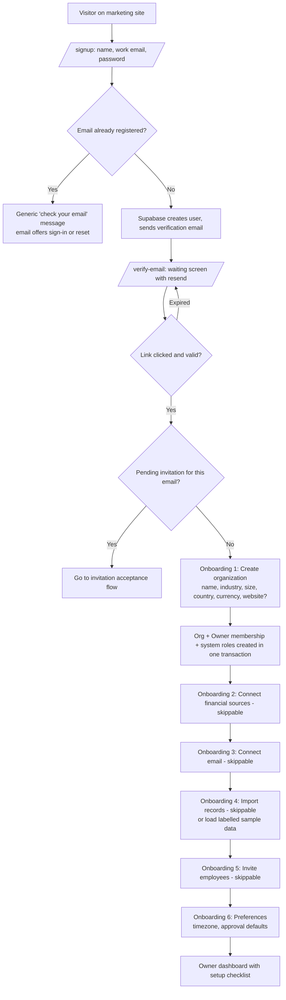
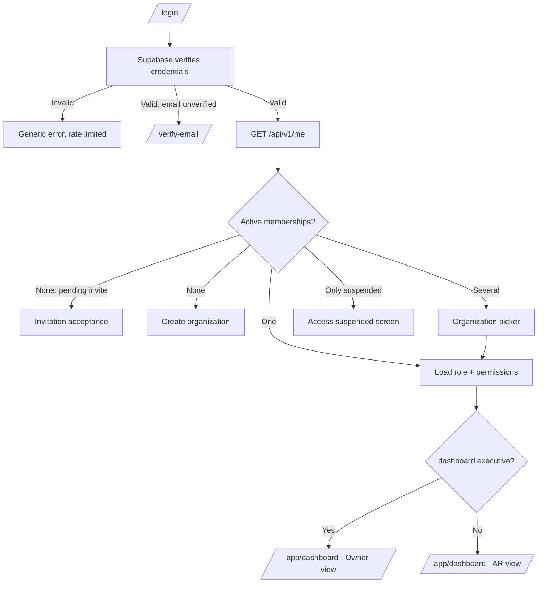
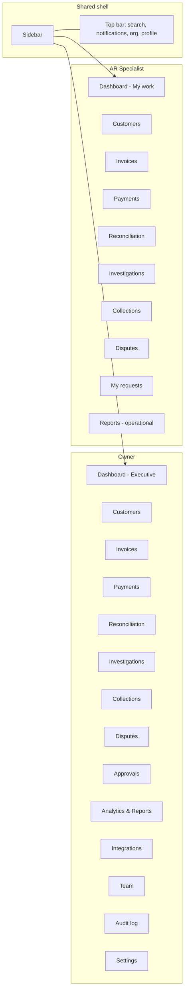
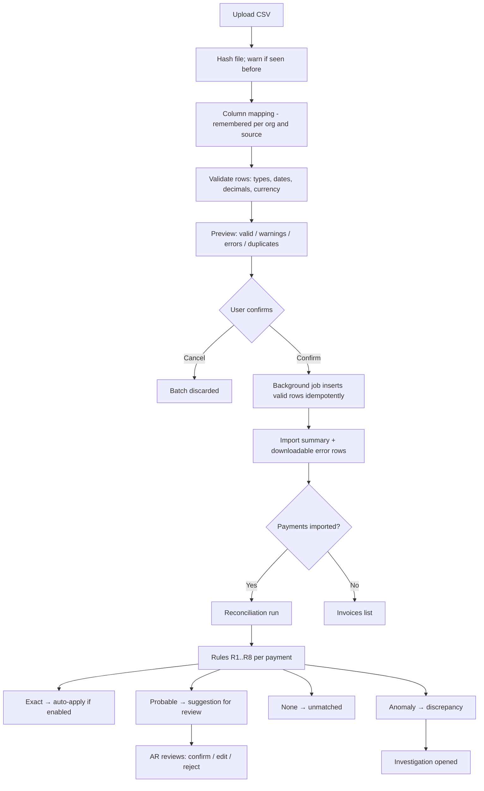
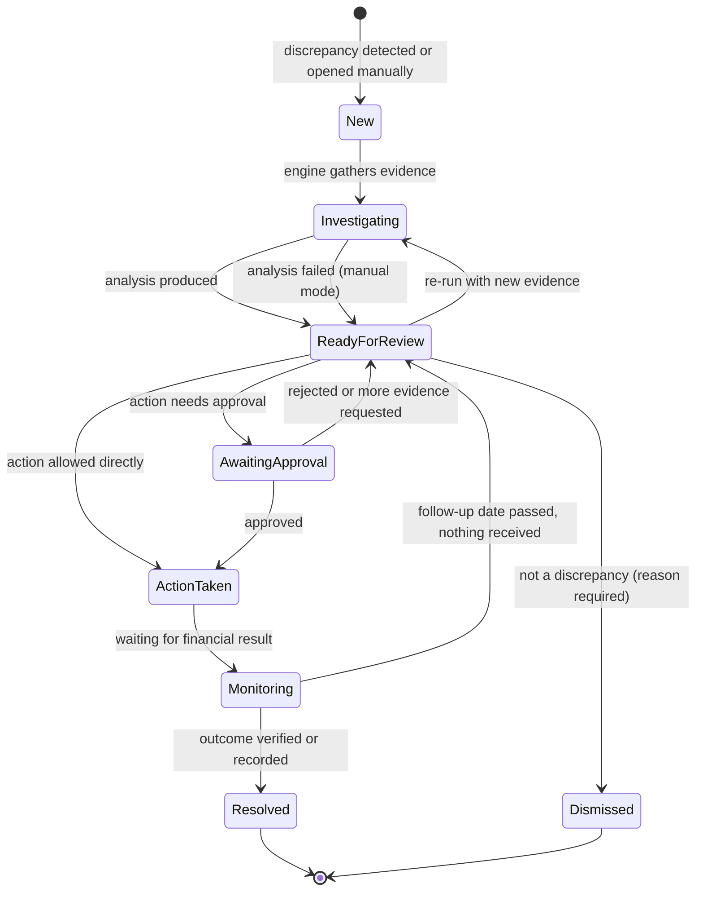
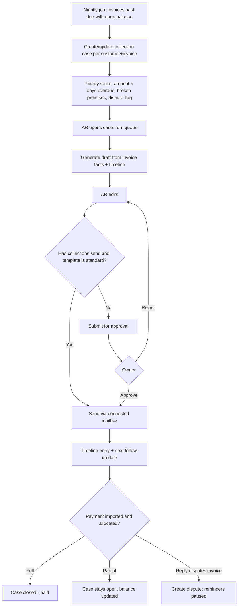
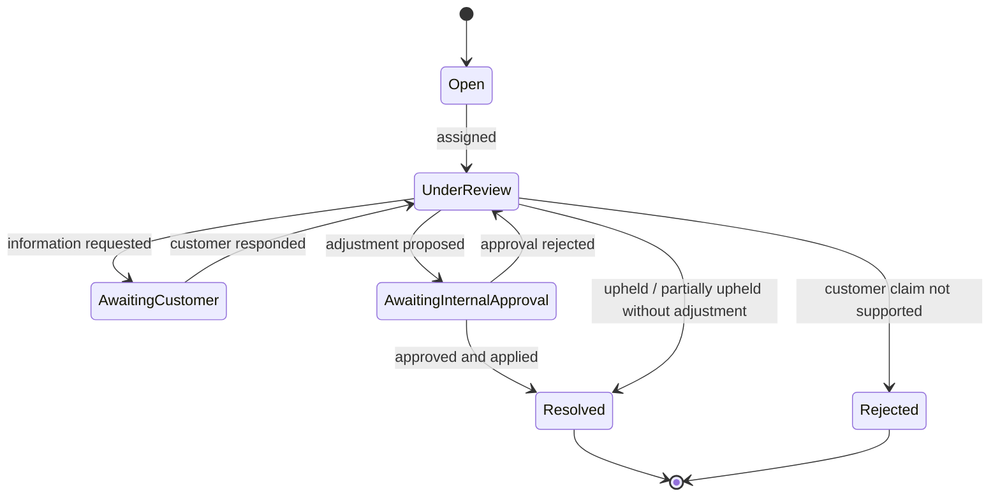

# Venn — User Flows

Status: Phase 1 draft · Last updated 2026-11-13

Diagrams are Mermaid. Each flow lists its failure paths, because those are where products feel broken.

## 1. Signup and onboarding



Notes
- Steps 2–6 are skippable and resumable; progress is stored on the organization (`onboarding_state`).
- The signup response never reveals whether an email is registered (prevents account enumeration).
- "Sample data" is clearly labelled demonstration data and can be removed in one action. **Decision D-11.**

## 2. Login and application routing



## 3. Employee invitation

```mermaid
sequenceDiagram
    actor Owner
    participant Web as Venn Web
    participant API as Venn API
    participant DB as PostgreSQL
    participant Mail as Email service
    actor Emp as Employee

    Owner->>Web: Settings → Team → Invite (email, role)
    Web->>API: POST /members/invitations
    API->>API: require team.manage; check not already member
    API->>DB: insert invitation (token hash, role, expires in 7 days) + audit
    API->>Mail: invitation email with single-use link
    Mail-->>Emp: "Owner invited you to <Org> on Venn"
    Emp->>Web: opens /invite/{token}
    Web->>API: GET /invitations/{token}
    API-->>Web: org name, role, invited email (or expired/used)
    alt No Venn account
        Emp->>Web: sets name + password (email fixed to invited address)
        Web->>API: signup; email treated as verified via token possession
    else Has account
        Emp->>Web: signs in with the invited email
    end
    Web->>API: POST /invitations/{token}/accept
    API->>API: authenticated email must equal invited email
    API->>DB: create membership in EXISTING org, mark invitation accepted, audit
    API-->>Web: membership
    Web-->>Emp: AR Specialist dashboard
    API-->>Owner: notification "Employee joined"
```

Failure paths: expired → "ask your admin to resend"; already used → sign-in prompt; signed in as a different email → explain and offer sign-out; invited role no longer exists → the invitation is invalidated (it does not silently fall back to another role).

## 4. Navigation by role



Sidebar grouping (both roles; items hidden when the permission is absent):

| Group | Owner | AR Specialist |
|---|---|---|
| — | Dashboard | Dashboard |
| Receivables | Customers, Invoices, Payments | Customers, Invoices, Payments |
| Work | Reconciliation, Investigations, Collections, Disputes | Reconciliation, Investigations, Collections, Disputes |
| Control | Approvals (count), Analytics, Reports | My requests (count), Reports |
| Admin | Integrations, Team, Audit log, Settings | — |

## 5. Import → reconciliation



## 6. Investigation lifecycle (user view)



Resolution outcomes: `recovered_verified`, `partially_recovered`, `adjusted` (credit/discount/write-off approved), `customer_correct`, `duplicate_refund_recorded`, `no_discrepancy`, `unrecoverable`.

## 7. Human approval

```mermaid
sequenceDiagram
    actor AR as AR Specialist
    participant API
    participant Pol as Policy service
    participant DB
    actor Own as Owner

    AR->>API: POST action (e.g. write-off 1,000.00 on INV-1042)
    API->>API: require adjustments.request
    API->>Pol: needs approval? (type, amount, actor)
    alt Not required
        Pol-->>API: execute
        API->>DB: apply + audit (one transaction)
    else Required
        Pol-->>API: approval required
        API->>DB: approval(pending) with payload snapshot + evidence refs + audit
        API-->>AR: 202 "Submitted for approval"
        API-->>Own: notification
        Own->>API: GET /approvals/{id} (payload, impact, evidence, history)
        alt Approve
            Own->>API: POST /approvals/{id}/approve (comment)
            API->>API: require approvals.decide; decider ≠ requester
            API->>DB: re-validate payload against current record state
            alt Still valid
                API->>DB: approval(approved) + execute action + audit (one transaction)
            else Record changed
                API->>DB: approval(stale)
                API-->>Own: "Invoice changed since request — ask requester to resubmit"
            end
        else Reject
            Own->>API: POST /approvals/{id}/reject (reason required)
            API->>DB: approval(rejected) + audit
        else Request more evidence
            Own->>API: POST /approvals/{id}/request-info
            API->>DB: approval(info_requested); returns to requester
        end
        API-->>AR: notification with decision
    end
```

Key rule: the approved payload is a **snapshot**. Execution re-validates it; if the invoice balance changed since the request, the approval becomes *stale* rather than applying an outdated amount.

## 8. Collections



If no mailbox is connected the Send action becomes **Copy / mark as sent manually**, logged as a manual activity. Venn does not pretend to have sent anything.

## 9. Dispute



## 10. Integration connection

```mermaid
sequenceDiagram
    actor Owner
    participant Web
    participant API
    participant Prov as Provider (Google / Intuit / Stripe)
    participant W as Worker

    Owner->>Web: Integrations → Connect
    Web->>API: POST /integrations/{provider}/connect
    API->>API: require integrations.manage; create state + PKCE, bind to org and user
    API-->>Web: provider authorization URL
    Web->>Prov: redirect, user consents to listed scopes
    Prov->>API: callback (code, state)
    API->>API: verify state, exchange code
    API->>API: encrypt tokens, store connection(status=connecting) + audit
    API->>Prov: test call (e.g. profile / company info)
    alt Success
        API->>W: enqueue initial sync
        API-->>Web: status = connected, scopes shown
    else Failure
        API-->>Web: status = error with provider message
    end
    W->>Prov: paged sync with cursor
    W->>API: upsert by external_id (idempotent), sync_run record
```

## 11. Flow coverage of end-to-end scenarios

| Scenario | Flows |
|---|---|
| A New org signup/onboarding | §1, §2 |
| B Invitation | §3 |
| C Invoice import with duplicates | §5 |
| D Payment import and reconciliation | §5 |
| E Discrepancy → investigation | §5, §6 |
| F Approved action → verified outcome | §6, §7 |
| G Collection email | §8, §7 |
| H Dispute | §9 |
| I Owner approval | §7 |
| J Cross-tenant denial | All API calls; see TESTING_STRATEGY |
